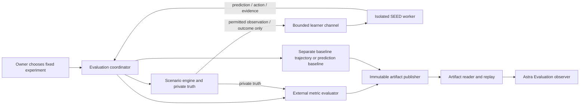

# B10 — Development Evaluation & Experimental Foundation

Date: 2026-10-02. Technical revision 3, with owner-approved storage-safety amendment dated 2026-10-03. **B10 DESIGN OWNER APPROVED / COMPLETE; STORAGE AMENDMENT OWNER APPROVED / MERGED / VERIFIED AT DOCUMENTATION-CI LEVEL.**

B10 overall: **IN PROGRESS**. Original design approval `6cd7504b96dec158bbedbadec4f133150f0e80b9`; the [storage-safety amendment](2026-10-03-b10-foundation-storage-safety-amendment.md) supersedes only the SQLite native-open threat-model promise. Current authority: **B10 FOUNDATION REVIEW REMEDIATION — R1–R10 ONLY**, including gated foundation publication and separate closure. Foundation LOCAL ACCEPTANCE VERIFIED / HOSTED PUBLICATION PENDING at engineering head `912b95b95bf696e599ff91ec33e5be638f5a7031`. Original stopped checkpoint `df0569a99f192a576fa2d60d0c2050500403fbc9` remains historical/exactly preserved. R1–R10 RESOLVED; independent review 0 BLOCKER / 0 MAJOR / 0 MINOR / 0 unresolved; G1 PASS / G2 PASS — foundation scope. Author foundation 156 passed / full suite 1039 passed with 2 existing warnings / 94 explicit adversarial regressions / seven standalone regressions PASS. I09–I30 and empirical NOT STARTED / NOT AUTHORIZED. NO B10 EXPERIMENTS EXECUTED. INSTALLED SEED UNTOUCHED. Original dated authority records remain historical. This specification is not proof of pending hosted publication/closure.

## 1. Verified starting state and authority

The working tree was clean on `seed-0.2-b10-design` at exact HEAD `5c90d6683450dab64713ca09104e2ec70a0199bb`. Authenticated GitHub inspection confirmed the remote branch at that SHA and [SEED verification run 36909840669](https://github.com/Jeruzael/SEED/actions/runs/36909840669) at the same SHA, completed successfully: `linux-py311`, `linux-py313`, and `macos-py313`. This is existing baseline CI evidence, not a new B10 verification run. The Linux 3.11 scenario step was skipped by the existing workflow; its full-suite job succeeded. B9 source/CI closure remains [PR #14](https://github.com/Jeruzael/SEED/pull/14), merged master `b7d8b832924c7ff1512708965fa021fed4306866`, schema v7.

**Historical revision starting state:** clean `seed-0.2-b10-design` at `189f8ce507f791fd5ac4c4a1b04d0b7a0b3855fb`, parent `5c90d6683450dab64713ca09104e2ec70a0199bb`, exactly one design-only commit ahead of that baseline. Its diff contains only this specification, the tracker and implementation log. That historical owner instruction authorized revision of those documents only, with no implementation planning, code/tests, experiment execution, publication/PR, deployment or installed-organism access. Original baseline/CI evidence above remains historical; no new hosted CI is claimed for this revision.

**Historical final hardening starting state:** clean `seed-0.2-b10-design` at `030636bae38434dba3022a909845a8b3eb9c2f7f`, parent `189f8ce507f791fd5ac4c4a1b04d0b7a0b3855fb`, exactly two design-only commits ahead of pre-B10 baseline `5c90d6683450dab64713ca09104e2ec70a0199bb`. All existing differences are limited to these three documents. That historical task authorized final design hardening only; no implementation planning, execution, source/test/schema/dependency/workflow change, Astra implementation, PR/merge, B11–B16, installed-home access or deployment. At that historical checkpoint, the full revised specification remained pending final owner approval; approval is now recorded below.

**Owner approval provenance — 2026-10-02:** the complete specification at `6cd7504b96dec158bbedbadec4f133150f0e80b9` is **OWNER APPROVED / COMPLETE**, including the external coordinator/truth boundary; frozen/prequential protocols and score-before-current-learning/minimal durable SCORE_ACK; action-conditioned A, rest-only hidden-shift B, evidence-integrity C and constrained-decision D; no forced exposure and existing predictor history/support limits; preregistered AnalysisPlan/digest/freeze, complete metric accounting and separate execution/measurement/finding states; learner/evaluator storage and one-way dependencies; deterministic controls/fair baselines; bounded artifacts, independent scientific/integrity digests, replay versus re-execution; observer-only Astra, adversarial review and all 22 future acceptance gates. This status-only record does not amend technical requirements. Publication, PR, independent review, hosted CI, gated merge and exact post-merge verification are authorized. B10 overall remains IN PROGRESS; implementation plan and implementation remain NOT STARTED / NOT AUTHORIZED. The next development phase requires a separate **B10 IMPLEMENTATION PLAN ONLY** instruction.

The [canonical roadmap index](../../roadmaps/seed-b10-to-0.3-development-roadmap-v1.0.md) and [original 38-page v1.0 PDF](../../roadmaps/SEED_B10_to_0.3_Development_Roadmap_v1.0.pdf) are authoritative. PDF SHA-256: `dc10f7df7dd5e6f51f07ab9634559eae3fa61b232eba020e98b023f9f9409188`. Roadmap approval establishes direction, with **IMPLEMENTATION AUTHORIZATION: NONE**. The design is now owner-approved; the current instruction authorizes its documentation publication/verification only. Proposed v1.1 concepts remain outside it. The [tracker](../../seed-0.2-development-plan.md) and [implementation log](../../implementation-log.md) distinguish historical checkpoints from this design checkpoint.

## 2. Purpose, scope and non-goals

**LOCKED:** establish trustworthy evidence about existing B1–B8 learning, prediction, adaptation, uncertainty, provenance, self-description and resource constraints. A reproducible negative, null or mixed result is a successful scientific outcome. No global intelligence/development score, forced improvement gate, anthropomorphic claim, or inference of causality from an uncontrolled trend is permitted.

B10 proposes a local experimental coordinator, synthetic scenario contracts, isolated use of existing mechanisms, separate frozen and prequential protocols, baselines, bounded immutable artifacts, replay/re-execution, and future read-only Astra inspection. These are design proposals only. B10 adds no developmental capability and changes no existing learner math, prediction algorithm, world-model update, curiosity formula, semantic rules, self-model semantics, decision weights, action catalog, schema or migration.

No production code, tests, APIs, UI, dependencies, CI workflows, persistence or runtime are changed by this task. Nursery, virtual body, skills, language, inquiry, reading, caregiver interactions, autonomous tools, real desktop control and B11–B16 behavior are excluded. No installed memory is read or copied. Existing baseline artifacts remain historical and byte-identical.

## 3. Audit of the machinery being evaluated

| Existing mechanism | Source boundary and experimental consequence |
| --- | --- |
| B1 experience | `seed/organism.py` and `seed/memory.py`: before/action/after; completed experience stores B2/B3/B5 and B8 evidence with a B4 work item. Q updating and later B4/B7 publication have separate transactions. A whole cycle is not atomic. |
| B2 prediction | `seed/predictor.py`: latest **200 raw completed rows**, corrupt rows do not cause refill; action-specific support requires **2** usable samples, then global fallback with 2, then persistence. Numeric mean deltas; Boolean outcome frequency. Confidence `min(0.95,n/20)` means evidence support, not calibrated accuracy. |
| B3 feedback | `seed/prediction_error.py`: pure evaluation of the already-created prediction against permitted outcome. Missing signals are not zero error. Aggregate error depends on available signals. Boolean Brier uses `probability_true`, never support confidence. |
| B4 world model | `seed/world_model.py`: exactly-once queued accumulation, publication from 2 samples, lifetime statistics and contradiction counts. It has no forgetting window or regime reset. Predictor adaptation and world-belief adaptation therefore need separate measurements. |
| B5 curiosity | `seed/curiosity.py`: bounded error/coverage/uncertainty/novelty calculation from prior B4 evidence. Auxiliary curiosity reflection is off by default. Magnitude is not intelligence. |
| B6 semantic memory | `seed/semantic_memory.py`: supported sources require at least 8 observations and confidence at least 0.30. Resource guards and cursor bound apply. Active/weakened/source-unavailable status, revisions and original provenance remain separate. Consolidation can occur as an action using previously published beliefs. |
| B7 self model | `seed/self_model.py`: bounded source-derived publication plus pure freshness projection. Most sources have a 60-second freshness policy. Storage page/allocation facts are platform-dependent; source IDs and recorded evidence must be checked independently. |
| B8 decisions | `seed/decision.py` and `seed/decision_record.py`: shared bounded candidate prediction/Q snapshot before selection; resource eligibility; `0.50*Q_component + 0.35*(1-risk) + 0.15*(1-uncertainty)`; eligible-only epsilon exploration and injected random ties among maxima. Selected prediction is linked by the existing canonical SHA-256. |
| Construction and clocks | `SeedOrganism` and `Memory` constructors write, recover work and initialize telemetry. They cannot construct a frozen reader. Core cycles use wall/monotonic time, UUIDs and randomness. Synthetic workers must replace host perception before construction, not after the first sensor call. |
| B9 observer | `dashboard/app.py` and read services use bounded, local read-only access. Astra renders recorded evidence and does not recompute historical cognition. Evaluation inspection follows the same separation. |

B8 blocks reflect/consolidate when load `>0.8`, battery `<20` while uncharged, disk `<10`, or needed resource evidence is unknown. Observe/rest remain eligible. Legacy reward retains its low-disk consolidate preference; evaluation reports the eligibility constraint and preserved reward separately rather than changing either. All literal decimal equations illustrate mathematical values; later unit checks use absolute tolerance 1e-12 for binary64 arithmetic, while same-profile canonical re-execution remains exact.

Current-state validation permits missing keys and battery/charging/network `null`; it does not permit non-finite numeric load/disk. Missing load/disk fixtures omit the keys rather than passing `null` through normal cycles.

## 4. Architecture comparison and dependency direction

| Architecture | Benefits | Costs / judgment |
| --- | --- | --- |
| External coordinator with isolated learner worker and typed observation channel | Truth stays in the coordinator; actual mechanisms run in disposable homes; separate metrics/artifacts; clocks isolated from dashboard and coordinator. | Worker adapters and protocol checkpoint need careful equivalence tests. **PROVISIONAL — selected.** |
| One process containing learner, hidden scenario rules and scorer | Small extension of existing temporary-home scenario tests. | Learner can casually reach truth objects; global clock/RNG replacement leaks across components. **REJECTED as the formal experimental boundary**; existing tests remain useful characterization. |
| Evaluation mode embedded in cognition, or a second implementation of B1–B8 | Easy internal hooks or complete control. | Changes the system under measurement, creates duplicate algorithms and gives the evaluator upstream influence. **REJECTED.** |

**LOCKED one-way dependency:** `development/evaluation → seed`; no reverse dependency. Dependencies go from development tools to existing `seed` modules. No `seed` module imports evaluation, artifact readers or dashboard. Metrics consume captured evidence; they do not supply reward, eligibility, predictions, beliefs, Q values or capability claims. The baseline runner uses its own state and RNG. Astra Evaluation depends on the dedicated read-only evaluation reader only; it never starts an experiment, scores a transition or updates cognition. Its optional downstream route/service must not pull evaluator imports into `seed/**`. Ordinary cognition must start and operate with the evaluation package removed or disabled and its configuration/artifacts absent. Future acceptance inspects imports/dependencies mechanically and exercises that absent-evaluator startup; the precise AST/import-graph mechanism is PROVISIONAL. Optional dashboard route loading must survive a missing evaluation reader package with Evaluation unavailable; importing the dashboard must not make ordinary operation require B10. Merely documenting import direction is insufficient.

| Component | Responsibility and authority |
| --- | --- |
| Coordinator | Validate a registered versioned spec, assign bounded work, create isolated homes, order phases/checkpoints, enforce real deadlines, publish status. It has evaluator truth. |
| Scenario engine | Deterministically expose permitted states/outcomes and apply the selected synthetic action. Own hidden rules, keyed events and regime schedule. No host sensors or external actions. |
| Learner worker | Only existing B1–B8 cognition and narrow evaluation-local adapters. It receives observations and constant protocol acknowledgments. No scoring metadata, truth objects, scenario seed/config, artifact root or expected answers. |
| Metric evaluator | Score preserved pre-update predictions; audit state/provenance/constraints against independent reference facts. Never change the learner. |
| Baseline runner | Compute comparison forecasts from the same permitted history, or run a separately cloned eligible-random policy trajectory. No privileged information. |
| Publisher / reader | Strict schema, canonical content, integrity verification, immutable atomic publication, bounded indexed reads. No learner database writes. |
| Astra | Display artifacts with protocol, denominator, source, status and limitations. No execution, evaluator or cognition role. |

This is isolation for trusted checked-in code, not an OS sandbox for adversarial Python running as the same user. Separate processes and capability routing prevent accidental/casual truth access. Same-user hostile filesystem inspection is outside the guarantee; untrusted plugins/code/scenarios are prohibited. The owner-approved 2026-10-03 amendment explicitly excludes adversarial concurrent same-UID filesystem mutation during SQLite's internal native file-open interval (DB/WAL/journal/SHM), including intentional path swaps designed to defeat application checks. This exclusion does not authorize any foreign-root, arbitrary-path, evaluator-truth or installed-home use by trusted code. B10 is not an OS sandbox. Hostile same-UID filesystem sandboxing, capability-aware native SQLite VFS, signed artifact authenticity and OS sandboxing/containers solely for hostile evaluator-code defense are **DEFERRED**, not hidden B10 v1 prerequisites. B10 v1 does not adopt a custom/native VFS solely to close this excluded attack; native mechanisms remain possible future separately authorized work.

## 5. Feedback taxonomy and mechanical contracts

| Category | Examples | Permitted route |
| --- | --- | --- |
| **EVALUATOR_ONLY_TRUTH** | Rule coefficients, hidden causal configuration, regime boundaries, labels, expected answers, task-scoring weights; frozen analysis-plan metadata, external measurements/reports and empirical finding classifications. | Scenario/evaluator private memory and completed review artifacts only. Never worker input, settings, Q/reward, meta, experience, semantic memory or self model. |
| **PERMITTED_OBSERVED_OUTCOME** | Legitimately exposed battery/load/disk/network after a selected action or declared event. | Typed observation channel into the ordinary B1 transition, according to protocol. |
| **DEVELOPMENTAL_FEEDBACK** | Existing B3 discrepancy between prior prediction and subsequently exposed outcome; B5 derivation from that error and prior evidence. | Existing B1–B8 producer path after external scoring. This is valid feedback, not leaked answers. |

**PROVISIONAL contract:** coordinator-side scenario has `initial_observation`, `apply_action` and private evaluator access. Worker-side client has only `observation(phase, ordinal)`, `action_catalog()` and `apply(action, ordinal)`; it has no `truth`, `score`, `expected_result`, configuration enumeration, reflection or arbitrary method dispatch. Reset configuration is performed in the coordinator; worker reset receives only the first permitted observation. Methods return detached allowlisted mappings, not references to scenario objects. Envelopes are <=64 KiB, depth <=16 and <=4096 entries, with one outstanding request per worker; full historical rows are not sent in the scoring envelope. The coordinator derives permitted-history baselines from the owned initial checkpoint plus already-recorded completed transitions, using identical row IDs/order/cutoff/validity; it never sends its private configuration back. Requests carry protocol, phase and ordinal; unknown operations, duplicate/out-of-order requests, invalid actions, extra truth fields or excess bytes fail closed.

The four-action catalog is exactly `observe`, `reflect`, `consolidate`, `rest`. Action availability uses the existing catalog and existing B8 resource rules, never evaluator task utility. B10 observation schema v1 allows only battery_pct (finite [0,100] or null), charging (bool/null), load_ratio (finite [0,2]), disk_free_pct (finite [0,100]), network (bool/null), and local_hour (int [0,23]); missing keys remain missing. No other state fields or timestamps from a host are accepted. Parent messages follow this schema plus current validation and byte bounds. The finite load domain keeps subtraction/MAE safe for these experiments; other future domains require a new scenario/observation version. No experiment names conveying answers, regime labels or hidden annotations are passed through worker observations. Errors crossing into the worker use fixed codes, not secret-bearing strings. `SCORE_ACK` is a constant token without score or labels.

Learner-visible traces are checked for forbidden fields and sentinel truth strings. Completed artifacts with revealed rules are opened only by the coordinator/observer; their directory is not given to the worker. Artifacts never feed back into training. Timing is simulated: action duration and acknowledgment do not encode rule-specific delays. A real timeout terminates an incomplete run rather than exposing a variable feedback value.

## 6. Experiment specification and state isolation

**PROVISIONAL schema `b10_experiment_v1`:** closed-field mapping with experiment ID/version, family/scenario/rule version, protocol, driver identity, source commit and dependency-lock digest, execution profile, initial-state fixture ID/digest, seed list and RNG algorithm, phase lengths, logical clock schedule, fixed measurement windows, registered metric IDs/versions, predictor baseline IDs/versions, policy variant, maintenance schedule, observation schema/action catalog, and all requested limits. Public learner configuration is separate from private evaluator configuration. Both are recorded in scientific content but only permitted settings reach the worker. Unknown IDs/versions/fields are errors, not best-effort execution.

Experiment IDs use `[a-z0-9][a-z0-9-]{0,63}`; versions are positive integers. Inputs are fixed before any run. Default seeds are the predeclared integers **0,1,2,3,4**. No post-result seed selection, parameter tuning or replacement of an unfavorable run. Future confirmatory claims require a new experiment version and separately predeclared seeds. Dirty source execution is rejected in v1; source commit must exist and tracked code/dependency content must match it. No artifact-supplied executable, expression, module path, import target or code payload is accepted.

### B10 Analysis Plan and preregistration

**LOCKED scientific invariant:** a first-class versioned **B10 Analysis Plan** binds the analyses before the first measured transition/probe. The proposed v1 coordinator freezes it durably before dispatching any run (including training), a stronger ordering than the minimum. No training/held-out outcome can select the plan. A suite uses one frozen plan with explicit family/protocol/variant populations and member inventories; every member cites the same plan version/digest and its declared subset. Experiment-spec metric/window/seed fields must exactly agree with it; conflicting declarations are INVALID before learner work.

**PROVISIONAL closed record `b10_analysis_plan_v1`:**

| Registered field group | Required content |
| --- | --- |
| Identity | Experiment ID/version; family/scenario/rule versions; protocol(s) and variant IDs; positive integer `analysis_plan_version`. |
| Measurement inventory | Allowlisted metric IDs/versions; stable measurement IDs and expected per-run and suite output inventory; question IDs and their measurement dependencies. Compact templates must expand deterministically before dispatch; no data-dependent metric removal. |
| Populations and windows | Training/measured distinction, action/signal/variant strata, exact ordinal/exposure windows, target opportunities; exclusions, eligibility/support/coverage rules and reason codes. |
| Sampling and analysis | Full seed set, baseline IDs/versions and paired eligibility, aggregation and action-standardization rules; missing/unavailable handling and allowed NOT_EVALUATED cases with reasons. |
| Thresholds and findings | Each threshold's ID/version/value, bound metric version/population, comparison direction and insufficient-evidence behavior; preregistered question-classification rules, or explicit descriptive-only disposition. |
| Freeze provenance | `analysis_plan_digest`, `frozen_before_execution=true`; immutable freeze receipt identifying plan/experiment version and planned first measured phase/ordinal per member. Receipt must precede dispatch, not be inferred from a post-run timestamp. |

The digest is SHA-256 of `b"SEED_B10_ANALYSIS_PLAN_V1\0" + canonical_plan_bytes`, using section 15's typed canonical encoding. Hash the complete registered plan body with its version; exclude only its own digest and incidental freeze-receipt time/storage ID. No scientific plan field may be excluded. The immutable evaluator-side receipt binds those body bytes/digest and the freeze assertion. The boolean is a verified ordering assertion, not permission to set a flag after execution. An absent/mismatched freeze receipt or digest prevents measured dispatch. Freeze checking happens before the protocol boundary, not through extra fields/work in the minimal SCORE_ACK frame.

**LOCKED no post-start mutation:** once the first measured transition/probe begins, metrics, thresholds, windows, seed set, exclusions, eligibility, coverage, aggregation, action-standardization, baselines, unavailable handling, inventory and finding rules cannot change for that run or be silently replaced under the same experiment/plan identity. V1 never overwrites a frozen plan even before measurement. A defect requires a new experiment version and/or analysis-plan version, a new digest, an explicit change explanation and a fresh execution for scientific results under the revised plan. Reanalysis of historical bytes may be retained only as EXPLORATORY_DIAGNOSTIC; it is never revised preregistered evidence for the original run. Historical artifacts retain their original immutable plan, rules and results. No result-based seed substitution or repeat-until-positive execution is allowed.

### Learner and evaluator storage domains

**LOCKED nonoverlapping domains:** **LEARNER_STATE_ROOT** contains only the assigned worker's disposable DB, required learner settings, learner-generated B1–B8 developmental evidence and worker-owned temporary state. **EVALUATION_ROOT** contains experiment specs, frozen plans, private configuration/truth, parent-owned score checkpoints, measurements/findings, digests, indexes, replay artifacts and execution metadata. Evaluation reports, labels, plan metadata and evaluator-only files never become B1 experience, B4 beliefs, B6 semantic memory, B7 self-model evidence, B8 Q/reward/decision inputs, learner configuration or normal knowledge. Legitimate observed outcomes and unchanged normal B3 feedback remain allowed.

No hidden-truth/evaluator table or migration belongs in learner SQLite; semantic memory is not a report store. The worker receives its assigned LEARNER_STATE_ROOT and a closed observation/ACK channel, never EVALUATION_ROOT, evaluator artifact paths or analysis-plan metadata through settings/config/APIs. Learner-facing resolution/open contracts fail closed for evaluator paths; truth sentinels must be absent from every learner-visible table/file. Astra reads artifacts only through its dedicated evaluator reader; it cannot substitute artifacts for an absent learner home. An absent evaluation root does not break ordinary cognition or other Astra views. These are mechanically tested trusted-code capability/storage guarantees, not OS filesystem denial against arbitrary same-UID hostile Python (section 4).

Each run uses a newly spawned worker and coordinator-created disposable home under a fixed development workspace. Existing `TemporaryDirectory`/mock-perception scenario patterns inform adapters; no in-memory substitute silently replaces the real SQLite persistence. Default starting state is a freshly initialized schema-v7 home with explicit settings and deterministic identity/time. Named fixtures are producer-generated from permitted transitions; fixture modifications used for robustness are declared and hashed before measurement.

Copy a closed/checkpointed learner using SQLite's consistent backup facility, not file-copying a live WAL. Every clone gets a new home, connection, lock, process, RNG and cache. Clone logical table contents, settings and sequences; do not copy installed identity or owner data. Worker receives only its assigned home and never a foreign-home identifier. Capability/path validation rejects requests to open another run; this is not a same-UID malicious-code sandbox. Repeated protocols/variants are separate runs or explicitly declared subcases with fresh clones. No implicit carry-over from A to B or between seeds.

**Owner-amended SQLite storage contract (2026-10-03):** the only trusted writer for each learner DB is its assigned evaluation worker. Before connecting, validate the fixed checkout-owned directory, assigned capability/directory identity, effective ownership/type, expected filename, existing regular file/no symlink/unsafe hard-link checks where detectable, and root/reservation bounds. No arbitrary path or installed-home fallback. For an already-created DB, prefer existing-file semantics such as `mode=rw` where compatible with normal producer behavior; fresh initialization uses only explicitly admitted evaluator-owned state. Immediately after a successful connection, revalidate expected main DB identity/type/owner, capability directory identity and observable SQLite database path/facts. A detected pre/post conflict is terminal: do not use the state as valid scientific evidence. During operation, perform bounded periodic/transaction-boundary identity, physical-growth, observable WAL/SHM/journal type/owner, capability and root/reservation checks. Revalidate identity/capability before checkpoint/clone/publication; never publish a checkpoint as trusted after a detected mismatch. Native SQLite opens cannot be bound race-free through Python's standard sqlite3 API; detection is not a promise to prevent preliminary native reads. Controls protect against accidental path misuse, stale/foreign capabilities, unsafe pre-existing paths and incorrect trusted-code routing. Malicious concurrent same-UID native-open races alone are outside this guarantee; every detected mismatch still stops/fails closed.

| State | Isolation and snapshot treatment |
| --- | --- |
| B1 episodes/experiences, B2 predictions, B3 errors, Q | Fresh per-run DB or exact owned fixture clone; include all rows and source IDs in initial-state identity. |
| B4 beliefs, pending statistics/work queue | Complete snapshot, drain permitted training work before freeze; reject frozen snapshot with pending work. |
| B5 assessments / attention meta | Separate DB/meta; auxiliary reflection off. No shared cooldown/cache. |
| B6 semantic current/history/runs/cursor | Preserve provenance and revisions; no global cache. |
| B7 singleton / summary evidence | Preserve original stored source snapshot; freshness projection uses controlled read time. Never fabricate a new frozen publication. |
| B8 decision history / linked prediction | Preserve both, including canonical selected-prediction link. No historical reranking. |
| Other tables/meta/settings/commands/runtime | Snapshot and freeze all tables, including operational tables and `sqlite_sequence`, to make mutation checks stronger. No pending commands; no owner automations or command processing. |
| Clocks/RNG/UUID | Fresh named streams and logical schedule per run; restart restores declared counter state, never live process state from another run. |
| Files/artifacts | Worker gets its home and channel only; publisher root is separate and never mounted as learner data. Operational evaluation logs are sidecars, not cognition. |

Coordinator uses bounded real time for enforcement; learner uses logical time. No `main.py`, normal autonomous `run()`, default home fallback, installed service, network probe, shell command, external tool or host-sensitive perception is involved in a future experiment. Today only repository documentation is being edited.

## 7. Frozen held-out protocol

**LOCKED purpose:** what does the already-trained state predict/select without changing the measured learner? **PROVISIONAL sequence:**

1. TRAIN in an owned mutable worker using normal cycles and the declared maintenance schedule. Record training evidence, but label it training.
2. Finish the last cycle, drain B4 work, close the worker, produce consistent trained SQLite snapshot and logical-state digest. Reject incomplete training or pending commands/work. No snapshot is selected based on held-out results.
3. Start a separate frozen worker with read-only SQLite, query-only mode and write-denying authorizer. It uses a minimal read facade (`db`, lock, `get_q`, `get_meta`) sufficient for existing Predictor/Learner reads and DecisionSystem preparation/selection. It never invokes `Memory`/`SeedOrganism` constructors, learner update, world-model recovery, consolidation or self-model publication.
4. Supply held-out observations using a distinct scenario phase/stream not consumed during training. Predictions and optional eligible selections use the fixed trained Q/history/beliefs. Preserve prediction before supplying the corresponding outcome. Apply synthetic environment effects only.
5. Score externally and record in artifact sidecars. Pure B3 evaluation, B5 assessment and B7 freshness projection may be computed as **frozen diagnostic projections**, never published to learner storage or described as newly learned state.
6. Recompute the complete logical snapshot digest after each subcase and at completion; require equality. Read-only database bytes must also remain unchanged. Reject attempted writes immediately and mark protocol failure.

Held-out outcomes cannot enter B2 history, episodes/experiences, prediction/error rows, Q, B4 statistics/queues/beliefs, B5/attention state, semantic records, self model, decision history, settings/meta or operational tables. Frozen B2 always uses the same latest 200 **training** rows; no online sliding held-out history is allowed. Missing/unsupported predictions remain reported.

Allowed changes: coordinator scenario state, external event ordinal/RNG, reader-local temporary prediction objects and external metrics/artifacts. Reader caches cannot accumulate learner evidence. Each independent held-out trial receives its declared reset context; no outcome from a prior trial is inserted into training. If a future scenario requires a continuous environment, continuity is explicit in a new scenario version, still without learner mutation.

Frozen results are explicitly **FROZEN_SELECTION_ASSAY**: eligibility, candidate prediction, selection/pool/provenance, predicted external consequence and permitted synthetic environmental consequence may be inspected. Normal `reflect` changes legacy cognitive concepts and normal `consolidate` can revise semantic state; neither internal mutation is invoked during a frozen assay. Record `driver=frozen_projection_v1`, `assay_kind=FROZEN_SELECTION_ASSAY`, `internal_action_effects=suppressed_by_protocol`. An action label is a selection, not evidence of normal end-to-end execution. No frozen promotion/revision/Q/current-transition-learning outcome is claimed, even if a synthetic external action effect is applied. Do not compare these task-policy outcomes with live online runs.

**Prequential evaluation is required** for normal action side effects, reflection-driven cognitive updates, semantic consolidation, Q updates, current-transition learning and downstream B4/B6/B7 changes. Frozen evaluation answers the fixed-state prediction/selection question; prequential evaluation asks how the actual developmental system behaves and updates as experience unfolds. The claims remain separate. Frozen B7 can become stale as logical time advances: preserving that staleness is correct. The descriptor never substitutes evaluator truth for missing stored capability evidence.

## 8. Prequential online-adaptation protocol

**LOCKED order:** permitted pre-observation → candidate predictions → optional eligible selection/action → permitted outcome → minimal external pre-update scoring checkpoint durably persisted → constant `SCORE_ACK` → normal learning from that transition → next transition. Full metrics/publication are outside the ACK gate.

**PROVISIONAL driver `existing_cycle_adapter_v1`:** use actual `SeedOrganism.cycle()` in a disposable worker. An evaluation-local synthetic Body adapter is installed before construction. The adapter exposes exactly before/after perceptions; it does not instantiate host Body or call reachability/sensors. Existing internal reflect/consolidate actions still run on prior stored evidence; scenario action effects are applied alongside those internal actions. The coordinator never chooses SEED's action. Existing constructor recovery/identity/settings writes occur before the measured phase and are captured in initial-state identity.

A wrapper at the existing core `evaluate_prediction` call boundary receives the already-selected prediction and permitted outcome. It computes the existing pure B3 result without alteration, sends preserved evidence to the coordinator, and waits for fixed `SCORE_ACK`. The external evaluator computes only a bounded **single-transition point-score vector** and durably checkpoints that vector with the exact pre-update evidence. After successful checkpoint persistence, the coordinator sends the constant acknowledgment; the wrapper returns the original B3 result, allowing curiosity, legacy reward/Q update, completed transition, B4 recovery and B7 publication. The captured B8 prepare/select evidence still proves candidate predictions preceded selection; no post-outcome prediction reconstruction is accepted.

### Minimal durable checkpoint — `b10_preupdate_checkpoint_v1`

A parent-owned `preupdate.ndjson` journal contains one closed frame per attempted current-transition learning event. The header fields are exactly:

| Field | Closed type / meaning |
| --- | --- |
| `checkpoint_schema` | Constant `b10_preupdate_checkpoint_v1`. |
| `scoring_event_version` | Integer 1, point-score definitions below. |
| `run_id` | Assigned 32-hex storage ID; execution identity, not a learner input. |
| `protocol` | Constant `prequential`. |
| `phase`, `subcase` | Declared training/measured phase and registered subcase ID, each <=64 ASCII bytes. |
| `transition_ordinal` | Integer 1–1024 within the declared phase/subcase; not a future SQLite transition ID. |
| `selected_action` | One existing action; matches captured prediction/selection. |
| `history_cutoff_id` | Exact signed-64-bit pre-update B1 row cutoff, or null for empty history; never advanced after current learning. |
| `prediction_sha256` | Existing B8 canonical selected-prediction SHA-256 (64 lowercase hex); preserves the original B2 payload identity. |
| `outcome_sha256` | SHA-256 of `SEED_B10_OUTCOME_V1` domain plus compact sorted finite JSON of permitted post-observation; no hidden truth. |
| `evidence_sha256` | SHA-256 of `SEED_B10_PREUPDATE_EVIDENCE_V1` domain plus compact sorted finite JSON of the closed evidence object below. |
| `point_scores` | Bounded external per-signal point losses/statuses; never transmitted in ACK. |
| `checkpoint_status` | Constant `CHECKPOINTED`, only made durable after validation and point scoring. |
| `ordering_marker` | Constant `PREUPDATE_SCORED_BEFORE_CURRENT_LEARNING`. |

The same frame preserves the referenced evidence, with exactly `phase`, `subcase`, `transition_ordinal`, `history_cutoff_id`, `state_before`, `selected_action`, `prediction`, `state_after`. Before/prediction/after each obey the existing <=16 KiB payload limit; header including point scores <=4 KiB, complete frame <=64 KiB. Evidence contains no run ID, real clock or evaluator labels, so its compact digest does not smuggle incidental metadata into scientific equivalence. `run_id` is excluded from the scientific projection as already specified. Digest domains are ASCII bytes followed by a NUL separator; compact JSON is the existing sorted ASCII, finite, no-whitespace encoding. These small identity hashes are not the final scientific or whole-artifact digest.

`point_scores` has exactly battery_pct/load_ratio/disk_free_pct/network_reachable. Each numeric entry has `status`, `absolute_error`, `unavailable_reason`; a valid prediction/outcome yields finite absolute error, otherwise null plus a fixed reason. The Boolean entry has `status`, `correct`, `unavailable_reason`, `brier_status`, `brier`, `brier_unavailable_reason`: correct is a Boolean only with valid predicted/observed booleans; Brier is `(probability_true-y)**2` only when genuine probability exists, otherwise null with reason. Each status is `scored` or `unavailable`; scored reasons are null. Reasons are restricted to `prediction_unavailable`, `outcome_unavailable`, `probability_unavailable`. Malformed/unknown prediction contracts fail validation before ACK rather than masquerading as honest missing evidence. All-unavailable is still an honestly evaluated point-score event, not fabricated zero error. No aggregates, normalization summaries, baselines or task utility belong in this frame.

Validate tuple/phase/ordinal/action/digests and point scores, append the full bounded frame, flush and successfully fsync the pre-created parent-owned journal before ACK. Journal creation/directory durability is completed once before learner work begins. A failed/partial write or fsync, malformed evidence, deadline or unexpected ordering yields **no ACK and no current-transition learning**: storage/deadline interruption is INCOMPLETE, protocol violation is FAILED. Retain the labeled prefix and any prior-evidence action mutations already performed; do not claim those were rolled back. One outstanding frame/ACK per worker prevents pipelining or duplicate acknowledgments.

The ACK contains **only the constant `SCORE_ACK` token**: no reward, correctness label, hidden answer, regime information, metric value, recommendation or task utility. External point scores remain evaluator-side and never replace B3 error, legacy reward, Q updates, B8 utility, curiosity or world-model evidence.

### Work after ACK

Per-window/full-run metrics, baseline scoring from captured pre-outcome cutoff/history, cross-run aggregation, final artifact construction, scientific/whole-artifact digest generation, indexes, UI summaries and comparison reports happen after the transition or run. None gates ACK. Baselines must still use the captured prior cutoff; later processing cannot incorporate the target outcome into its history. Publication joins checkpoint evidence and recorded update stages by tuple without rewriting historical cognition.

A later aggregation/index/digest/publication infrastructure failure after ACK does not invalidate permission already given to learn. Preserve actual learning state and durable checkpoints, let the already-authorized cycle finish under existing bounds when possible, mark the evaluation **INCOMPLETE**, stop before another transition, and record which updates finished or remain unconfirmed. Never pretend learning did not occur, silently roll back, or retry the transition and double-learn. A structurally invalid final artifact is not published as COMPLETED. The journal stays outside learner storage and is reused as a final payload file (or retained bounded partial), not duplicated into another full evidence copy. Post-ACK processing interruption is INCOMPLETE; a produced report that violates the registered inventory/contract is FAILED / SCIENTIFIC_REPORT_INVALID (section 12). Both retain actual learning/checkpoints, stop before another cycle and prohibit rollback, retry or double-learning. Neither is a fatal error in normal SEED cognition; the evaluation worker is bounded and disposable.

Internal reflection/consolidation before the outcome may update legacy concepts or semantic memory using **earlier** completed evidence. This is existing action behavior and is recorded as a prior-evidence action effect; it cannot ingest the current unfinished transition. Current-transition prediction/outcome learning remains after scoring. External metrics and expected task answers never replace B3, legacy reward or B8 utility. Q is still `old + alpha*(legacy_reward-old)`, default alpha 0.18, epsilon 0.15; B8 eligibility/weights/tie resolution are unchanged.

After every completed cycle capture the actual update IDs, Q change, world-belief delta, semantic status/revisions and self-model publication. Pure reference checks occur in the evaluator, not the worker. Optional scheduled owner-requested consolidation runs **after scoring and completion**, e.g. every 8 completed transitions in A/B, and is labeled `declared_maintenance`; it is not claimed to be autonomous initiative. The resulting semantic delta is captured separately. Default curiosity reflection remains off.

A minimal scoring-checkpoint commit is not a learner transaction commit. If Q changes but persistence/B4/B7 later fails, preserve `scored`, `update_started`, each completed update and terminal failure. Mark the run **INCOMPLETE**, never fabricate a complete transition or roll back science to appear successful. No automatic retry/relearning after ambiguous partial writes. Existing B8 stale decisions are skipped cycles, not core fatalities: count attempts separately, make no transition/error sample for them, advance the declared retry clock and stop at the retry cap. Completed-cycle limits count transitions; attempt limits also apply.

## 9. Determinism model

**PROVISIONAL:** reproducible canonical science within a recorded execution profile; no unconditional cross-platform byte equality promise.

| Source | Classification | Exact handling |
| --- | --- | --- |
| Scenario randomness | CONTROLLED | Counter-keyed SHA-256 of domain `SEED_B10_SCENARIO_RNG_V1` plus canonical array `[experiment_id,experiment_version,family,seed,phase,event_index,channel]`; draw is the first 53 digest bits interpreted unsigned, divided by 2**53, exactly in [0,1). Policy variant is excluded so cloned counterparts share exogenous draws. No action-dependent consumption of a shared RNG; counterpart policy runs get equivalent keyed exogenous events. |
| Learner decision RNG | CONTROLLED | Dedicated `random.Random` with seed equal to the unsigned 256-bit SHA-256 of domain `SEED_B10_LEARNER_RNG_V1` plus canonical array `[experiment_id,experiment_version,seed,protocol,variant,role]`; inject into DecisionSystem. Record Python implementation/version, stream algorithm/version, initial state digest and draws/choices. Separate any legacy random uses into named streams. |
| Baseline policy RNG | CONTROLLED | Same canonical named-stream seeding with separate domain `SEED_B10_BASELINE_RNG_V1`; never consumes learner or scenario stream. |
| Logical wall clock | CONTROLLED | Base Unix seconds `1800000000`; normal transition starts `base + 10*ordinal`; staged offsets 0 pre/selection, 1 start, 2 outcome/score, 3 update, 4 maintenance/publication. Training starts at offset 0; evaluation starts at offset `10*training_count`. Measured ordinal restarts at 1 after that offset; phase/subcase disambiguates event identities. C variants use the same declared frozen read time independently, with stale variant +301s. Phase offsets and fixture clocks are recorded and nonoverlapping where a single trajectory continues. Repeated calls within a stage return the same time. |
| Learner monotonic clock | CONTROLLED | Same staged offsets with nonnegative origin; ordinarily selection age <=1s. Skipped-cycle fixtures explicitly advance >5s and retry by the configured observation interval. Normal cycles do not infer host wake (10s <45s). |
| UUIDs | CONTROLLED | Counter-based 32-hex identifiers derived from SHA-256 of run scientific identity, role and ordinal, installed before imports/construction; counters captured. No timestamp/random UUID source remains. |
| Event/SQLite ordering | CONTROLLED | One learner writer, sequential ordinal/phase protocol, bounded ordered reads and deterministic IDs from cloned sequences. No parallel updates within a run. |
| Source, schemas, rules, initial state | RECORDED and validated | Exact commit, dependency lock, artifact/metric/experiment/scenario/adapter versions, all settings, logical initial-state digest and checkpoints. Changed scientific input means a different run identity. |
| Python/SQLite/OS/float execution profile | RECORDED | Versions, platform/architecture and compile/runtime SQLite facts. Same-profile re-execution required for exact comparison. Across profiles use explicit scientific metric comparisons, not automatic digest equivalence. |
| Actual start/end time, elapsed CPU/wall time, PID, absolute workspace, file allocation | ACCEPTED NONDETERMINISM | Execution envelope only. Do not use as training signal, selection input or scientific performance improvement; actual deadlines still bound work. |
| Host sensors, network, unseeded RNG, real learner clocks, concurrent writers, locale/timezone-dependent parsing | PROHIBITED | Fail closed; adapters must intercept before construction and restore only within the disposable process. No graceful fallback to live perception. |

The coordinator's real clock is never patched. Learner clock/UUID adapters cover default-bound clock callables as well as module references before importing producers. Raw runtime PID/storage facts are retained for integrity and source-fidelity review, but identified incidental fields are excluded from reproducible content (section 15). Logical timestamps that affect freshness/reward/protocol are scientifically relevant and included. Exceeding a real deadline can cause different incomplete prefixes; only complete same-profile runs make an exact reproducibility claim.

## 10. Initial shared suite and deterministic scenarios

**PROVISIONAL:** four families reuse one coordinator, worker boundary, artifact format and metric registry. Default suite remains **30 runs**: A 10 (5 frozen, 5 prequential), B 5 prequential, C 5 frozen robustness bundles, D 10 prequential (5 SEED, 5 paired random-eligible). Seeds 0–4 are fixed. These are scientific questions, not expected positive findings. Five seeds support descriptive evidence only, not significance or population generalization. Revised A/B scenario versions supersede unexecuted draft `stationary-v1`/`shift-v1`; source/experiment/rule identities record the new definitions. Counts, seeds and resource caps are unchanged.

Common valid context: battery 80%, charging false, load 0.5, disk free 50%, network false, local hour 12. Each trial has a permitted exogenous reset to that context before prediction, labeled a reset event. Synthetic consequences do not imply internal SEED actions cause these effects on a real host. Training and held-out observations have distinct phase/event identities. All outcomes follow the selected action and preserve normal domains.

| Family/version and scientific question | Protocol / declared counts | Scenario and measured scope |
| --- | --- | --- |
| **A — Stationary Action-Conditional Learning / stationary-action-v2**: can existing B2/B3 learn stable action-specific consequences, and does action conditioning add predictive value over simpler baselines where exposure permits? | Prequential: 0 training +400 measured. Frozen: 320 training +80 held-out. | Stationary action-dependent load rules below; action-independent battery -0.25 percentage points, disk -0.05 percentage points, outcome network true. No noise. B2/B3 prediction/support, B4 accumulation, B5 response, B6 promotion/provenance during mutable phases only. |
| **B — Action-Specific Regime Adaptation / rest-shift-v2**: when one learned relationship changes without warning, how quickly and honestly do predictor/world/curiosity/semantic mechanisms respond? | Prequential: 0 training +800 measured; old regime 1–320, new 321–800. | A rules except only rest's load delta changes from -0.10 to +0.05 at hidden boundary 321. Others stay stationary. Action-specific B2 adaptation versus global baseline behavior and B4 lifetime evidence; B5/B6 downstream response where exposure permits. |
| **C — Evidence Integrity & Uncertainty / evidence-v1**: how do B4–B7 represent insufficient/conflicting/unavailable/stale evidence without inventing certainty? | Frozen: 128-transition producer fixture; four variants with 16 probes each, 64 measured total. | Separately named conflict fixture has 64 load +0.10 then 64 load -0.10; it is not an A/B action-conditioning trajectory. Cold/conflict/unavailable/stale variants inspect frozen evidence/projections, never current learning or new consolidation. |
| **D — Constrained Decision Behavior / constrained-v1**: does B8 maintain guards/provenance, and how does task behavior compare descriptively with an eligible-random policy? | Two prequential trajectories/seed, each 0 training +128 measured. | Unchanged eight-context task below; SEED epsilon 0.15 versus baseline 1.0, alpha 0.18 and legacy reward unchanged. Policy trajectories differ. |

### A: stationary action-dependent rule and honest exposure

| Selected action | Load delta | Outcome load from 0.5 |
| --- | ---: | ---: |
| observe | 0.00 | 0.50 |
| rest | -0.10 | 0.40 |
| reflect | +0.10 | 0.60 |
| consolidate | +0.05 | 0.55 |

The registered A definition must validate at least two distinct coefficients for its designated action-conditioned signal; an accidental identical-effect mapping is INVALID_SPEC. Battery/disk/network remain controls. These coefficients follow owner-approved revision direction; registry/layout/measurement choices remain PROVISIONAL for final review.

Measured actions come from **unchanged B8 selection**, with default epsilon 0.15, existing guards/utility/ties and normal learning. Do not force exploration, change eligibility/Q, rotate actions, resample seeds, or rebalance the trajectory to populate a comparison. Report selected-action frequency, current 200-row per-action support, prediction method/fallback, paired usable sample count and coverage. B2 requires 2 usable same-action historical rows **at that prediction cutoff**. A formal action-conditioned comparison stratum includes only predictions actually using `action_mean_delta` with that support, while all-method comparisons separately retain global/persistence fallbacks. Publish stratum membership/exclusions; do not cherry-pick favorable errors.

A's fixed online early window remains **1–40**, late **361–400**. Frozen A reports all **80** held-out separately from training and online scores. Per-action window comparisons and equal-weight standardized changes require at least **5 paired usable samples for that action in both windows**; an action-conditioned-stratum summary also requires 5 eligible paired samples, in addition to B2's historical support 2. Raw individual point scores remain inspectable even below a summary threshold. No qualifying action yields **UNAVAILABLE / INSUFFICIENT_EVIDENCE**, not zero or an imputed unsampled action effect. A/B still declare resource-permitted post-cycle owner-requested consolidation every 8 completed transitions in mutable phases, not in frozen probes.

**Literal fixture `action-conditioning-four-row-v1`, not an autonomous trajectory:** four prior eligible transitions, two rest outcomes with delta -0.10 and two reflect outcomes with delta +0.10. Current load 0.50, selected rest, permitted outcome 0.40. All methods share these four raw rows, current observation, action, cutoff and target.

| Method | Used history/support | Predicted delta / load | Absolute load error |
| --- | --- | --- | --- |
| Persistence | No historical mean (four rows available but ignored) | 0.00 / 0.50 | 0.10 |
| Global-delta baseline | All 4 valid rows | `(2*(-0.10)+2*(+0.10))/4=0.00` / 0.50 | 0.10 |
| B2 action-conditioned | 2 valid rest rows; threshold 2 met | `(2*(-0.10))/2=-0.10` / 0.40 | 0.00 |

B2 support confidence is `2/20=0.10`; global-history support is 4, not a probability or accuracy claim. This one-target fixture verifies detectable mathematical differences; it has only **one paired scored target** and is not a window comparison satisfying the 5-sample reporting threshold. If all usable history is rest, global and conditioned means coincide and their errors may tie; if selected observe has no support, B2 may use global/persistence. Neither fixture nor scenario asserts B2 must outperform any baseline across actual action mixes.

### B: rest-specific shift, conditional mathematics and adaptation

Only rest's load effect changes at evaluator-only boundary **321**, from -0.10 to +0.05. Observe 0.00, reflect +0.10 and consolidate +0.05 stay unchanged, as do battery/disk/network controls. Worker observes consequences, never a boundary/regime label or revised coefficient. No action is forced to rescue sparse changed-action evidence.

At a post-shift rest prediction cutoff let **m** be usable old-regime rest samples still present and **k** usable new-regime rest samples still present in the latest **200 raw rows**. m and k count only already-completed contributors at the captured cutoff; the currently scored transition is excluded. If `m+k>=2`, B2's action-conditioned mean is `(-0.10*m+0.05*k)/(m+k)`. With current load 0.50, outcome 0.55, the theoretical unclamped absolute error is `0.15*m/(m+k)`. These are counts within the actual bounded history, **not total post-shift transitions or lifetime exposure**. Unchanged-action rows evict old rest rows too; k/m/action-conditioning availability therefore depend on the real selected-action mix. If support falls below 2, record B2's actual global/persistence fallback, not a fabricated conditioned estimate.

**Literal fixture `rest-replacement-20-v1`, not an autonomous adaptation curve:** conditional on exactly 20 valid rest contributors remaining in the raw 200-row window, with m=20-k:

| New-regime rest contributors k | Old contributors m | Conditioned mean delta | Predicted load / actual 0.55 | Absolute error |
| ---: | ---: | ---: | ---: | ---: |
| 0 | 20 | -0.10 | 0.40 / 0.55 | 0.15 |
| 10 | 10 | -0.025 | 0.475 / 0.55 | 0.075 |
| 20 | 0 | +0.05 | 0.55 / 0.55 | 0.00 |

The general global-delta baseline at the same cutoff is `(-0.10*N_rest_old +0.05*N_rest_new +0.10*N_reflect +0.05*N_consolidate +0.00*N_observe)/N_valid`, 2<=N_valid<=200; below2 usable samples the global baseline uses its declared persistence fallback, not division by an empty/one-sample mean. Stable-action counts combine both regimes. This mix-dependent diagnostic has no asserted universal adaptation rate or fixed sign flip. Its selected-rest error, coverage and unchanged-action errors are reported separately from B2's conditioned estimate.

For B4's **rest-scoped lifetime** belief, let n0 be actual valid old-regime rest evidence and q be actual valid new-regime rest evidence: mean `(-0.10*n0+0.05*q)/(n0+q)` when evidence exists, published only at the existing two-sample threshold. It reaches zero only at q=2*n0, unlike B2's window replacement. Fixture n0=20: q=20→-0.025, q=40→0, q=60→+0.0125. The global B4 lifetime mean uses actual summed action effects and counts; do not reuse a fixed 320-old-rest assumption or infer regime adaptation from action-mix changes. B4 has no forgetting/reset; old dominance or slow response is a valid negative finding. Contradictions are evaluated against the actual prior scoped mean/count and existing load epsilon 0.02; they do not have to increment on every new rest outcome once the lifetime mean moves toward zero.

B fixed transition windows remain pre-shift **281–320**, immediate **321–360**, late **761–800**. Report rest and each unchanged action separately, plus global-baseline diagnostics. Record the first observed post-shift rest point loss with its ordinal, first 5 rest-exposure errors as a separate descriptive window, support/exposure, paired counts, method and coverage. If there is no rest within an immediate/late window, its metrics are unavailable; a first exposure far after the boundary is not described as an immediate boundary response. Per-action early/late comparisons retain the 5 paired sample minimum.

Before assigning a B2 adaptation claim, require the captured rest candidate immediately before transition 321 to use action_mean_delta with at least 2 usable old-regime rest samples in its current 200-row history. Otherwise report **UNAVAILABLE / INSUFFICIENT_PRECHANGE_EVIDENCE**, even if later new-regime predictions become accurate; report that later learning separately. Inspecting the already-prepared rest candidate does not force its selection or expose the hidden boundary to the learner.

**Primary adaptation metric `prediction.adaptation-delay`, version 2:** index post-shift completed rest selections by exposure j, without filtering out hard/unavailable cases. Fixed exposure windows are j=1–5,6–10,11–15,...; each requires all **5 paired usable rest samples**, each with B2 action_mean_delta and historical support>=2. Missing/fallback entries make the window unavailable and break consecutive qualification, not vanish from the index. A window passes if conditioned load MAE<=0.02. Adaptation is the end of the first **three consecutive nonoverlapping passing exposure windows**. Report primary delay in rest exposures (last j), secondary delay in completed transitions (`end_ordinal-320`), all three windows' IDs/counts/errors, observed rest exposure and coverage. This replaces the original 20-total-transition adaptation windows; the 5-sample minimum, three-window confirmation and 0.02 tolerance remain.

No three consecutive fully eligible windows yields **UNAVAILABLE / INSUFFICIENT_EVIDENCE**, regardless of how many global transitions elapsed. If eligible three-window sequences exist but none pass, report `not_observed` with right-censoring at the **actual observed rest exposure**, and separately at 480 global post-shift transitions. A sparse action is not assigned a fabricated long/zero adaptation delay. Global-baseline errors, fallback frequency and unchanged-action behavior never share this action-conditioned delay label. B4 lifetime values/contradictions, B5 response and B6 revisions are separate metrics with their own actual evidence/opportunity counts.

C's cold fixture is freshly initialized with no training evidence. The conflict fixture is generated from registered permitted transitions through existing producer APIs, with declared action sequence `(observe,reflect,consolidate,rest)` repeated; it is labeled `producer_fixture_v1`, not an autonomous B8 trajectory. No invented B8 decision record is inserted. For unavailable-source robustness, the **fixture builder before freeze** replaces the referenced B6 source row's payload with a declared invalid payload while retaining its ID and row, then invokes existing consolidation to produce source-unavailable evidence; unavailable current observations omit load/disk or use permitted battery/network null. The stale variant freezes the stored model but reads at last evidence time +301s; B7 stale projection and B8 stale contributor status are honest outcomes. All fixture edits/maintenance are in initial-state provenance, not measured frozen updates. No corrupted/non-finite observation is forced through a normal core cycle; malformed-input rejection belongs to later negative tests. Each variant records an initial digest (unchanged clones may legitimately share that digest), before/after frozen equality and metrics. No newly promoted semantic memory is expected during frozen probes.

| C variant | Construction before freeze | Read-only measured claim / excluded claim |
| --- | --- | --- |
| Cold | Fresh empty owned fixture; no training publication invented. | B4 pending/no evidence, B5 pure unavailable/diagnostic handling, absent B6/B7 facts; no claim of promotion or new snapshot. |
| Conflict | 128 permitted producer transitions and declared B4 recovery/B6 consolidation/B7 publication during fixture building, with source IDs and versions recorded. | Inspect stored lifetime contradiction/value/provenance and frozen projections; do not measure additional belief updates or semantic revisions. |
| Unavailable | Retain referenced source row ID, invalidate declared source payload and run existing consolidation before freezing; freeze source_unavailable record/history. Observation probes separately omit permitted fields. | Inspect unavailable stored source and projected missing evidence; no frozen consolidation/repair or fabricated new publication. |
| Stale | Clone stored base state unchanged and use declared last-evidence+301s read time. | B7 freshness projection and B8 contributor staleness; do not publish a fresh self model or recover work. |

Every C probe carries FROZEN_SELECTION_ASSAY / frozen diagnostic projection labels. Setup mutations count only as fixture provenance; observed robustness never implies normal end-to-end reflect/consolidate execution. B6 lifecycle changes or B7 republishing require a separate prequential measurement if those are the scientific question; C tests their already-constructed evidence, not suppressed mutable behavior.

D context order: normal; load 0.9; battery 15 and charging false; disk 5; battery null; charging null; load key omitted; disk key omitted. Other fields remain common valid values. Reflect/consolidate must be ineligible in contexts 2–8; observe/rest eligible throughout. Exact boundaries 0.8/20/10 are separate acceptance fixtures. The scenario records action-dependent post-state: rest changes load by -0.10, reflect +0.10, consolidate +0.05, observe 0, using omitted-field preservation and clamping to nonnegative values; battery/disk remain unchanged; network becomes true for observe/reflect and false otherwise. Exogenous next-context resets are explicit. This is a synthetic controlled task, not an inference about host causal effects.

External D utility is **1.0 for reflect, 0.75 consolidate, 0.5 observe, 0.25 rest in normal context**; **1.0 rest, 0.25 observe, 0 for reflect/consolidate in constrained/unknown contexts**. Mean utility is the task metric only. It never enters legacy reward/Q or selection; zero guard violations is mandatory regardless of utility. No optimality claim is made. The two policy trajectories start with cloned equivalent state, use the same keyed exogenous contexts, and independently generate actions/outcomes/learned state. A random baseline is implemented conceptually through existing B8 exploration with epsilon 1.0 and its own RNG, so its decision record remains a valid certified exploration record rather than a forged SEED exploitation record.

## 11. Baseline methodology and comparison eligibility

**PROVISIONAL prediction baselines:** persistence and global-history mean delta / Boolean frequency. The latter ignores action conditioning but shares the actual selected action, observation, target ordinal, history cutoff and candidate usable rows. It uses up to the same latest 200 raw rows and the same validity filters; at least 2 usable samples are required, otherwise the same persistence fallback. Boolean probability is available only with at least 2 usable samples. Do not give any baseline scenario coefficients, future data, regime boundaries or privileged labels. Baseline confidence is unnecessary and never substituted for accuracy.

For each transition retain the frozen/online history cutoff, raw-row count, valid contributor IDs/digest, prediction method, value, probability availability and eligibility reason for every method. Compare methods on the **intersection of valid samples for the specified signal/metric**, with the same outcome and selected action. Publish each method's overall coverage and an eligibility cross-tab (both, SEED-only, baseline-only, neither); paired comparisons cannot conceal excluded hard cases. Probability comparisons use the smaller intersection with genuine `probability_true` for both. Persistence Boolean is still scored by classification accuracy, not a manufactured 0/1 probability Brier.

Report early/late per action as well as overall action mix, selected-action frequencies, historical support and paired usable counts. Baseline comparisons use identical selected transition/action, pre-outcome observation, history cutoff, outcome, validity filters and target-sample eligibility; identical input pools do not require the global baseline and action-conditioned method to average the same subset. A standardized early/late comparison uses equal weights across qualifying action set C supported in **both** windows with at least **5 paired samples each**, fixed by the published rule. On the same paired per-action populations, `standardized_window_MAE=fsum(MAE_a for a in C)/len(C)` and standardized change is early minus late using that same C. Unstandardized overall MAE remains total paired absolute loss divided by all paired samples, weighted by actual action frequencies. Empty C is unavailable, never division by zero. If no action qualifies, standardized change is unavailable. Publish the qualifying action set, excluded actions with reasons, per-action counts, standardized value and unstandardized overall value; absent qualifying actions are UNAVAILABLE / INSUFFICIENT_EVIDENCE, never zero. Changes in the qualifying action set across runs prohibit pooling standardized scores as if populations matched. Overall unstandardized trends are descriptive and explicitly subject to action-mix/exposure changes. No causal conclusion follows from lower error alone.

For policy comparisons, clone initial learner/environment state and rule configuration, not the later history. Both variants obey identical guards and task-scoring definitions. They may see different action-dependent outcomes and make different updates. Report paired seed-level task differences and trajectory-specific prediction metrics separately; never label those prediction samples identical. Random policy overhead has the same transition/attempt/time caps as SEED. Fixture-driven cases are not policy baselines.

## 12. Metric registry, equations and unavailable semantics

**PROVISIONAL metric IDs are versioned and allowlisted.** Registry v1 consists of `prediction.numeric-mae`, `prediction.numeric-normalized-mae`, `prediction.boolean-accuracy`, `prediction.boolean-brier`, `prediction.coverage`, `prediction.support-counts`, `prediction.window-change`, `prediction.adaptation-delay`, `world.first-belief`, `world.evidence-count`, `world.contradictions`, `world.revision-latency`, `world.stability`, `world.insufficient-evidence`, `curiosity.components`, `curiosity.bounds`, `curiosity.unavailable`, `semantic.promotion-latency`, `semantic.revisions`, `semantic.status-transitions`, `semantic.source-consistency`, `semantic.provenance`, `self.factual-fidelity`, `self.source-traceability`, `self.freshness`, `self.unsupported-claims`, `decision.constraints`, `decision.eligibility`, `decision.provenance`, `decision.prediction-link`, `decision.skipped-fallback`, `decision.q-compatibility`, and `decision.task-utility`; every entry except the version 2 adaptation metric has metric version 1 and the equations/population/status definitions below. Count/status metrics return explicit count mappings, not an artificial scalar grade. The revised action-exposure definition uses `prediction.adaptation-delay` metric version 2; all other metric definitions remain version 1 with revised scenario/version identities. No user-provided formula execution. A measurement records metric/version, unit, phase/variant/window/action/signal, numerator and denominator or support count, eligible population, value or `unavailable_reason`, and source ordinal/IDs. Missing is null with reason, not zero, perfect accuracy or failed intelligence. Every claim links raw evidence.

### Complete measurement accounting and finding hierarchy

**LOCKED anti-selection-bias rule:** every registered metric and each expanded registered measurement must appear in the final scientific output, including unfavorable, sparse and unavailable results. The plan's expected inventory determines output, never the nicest graph. The default A–D plan accounts for all 33 registry IDs for each member run; it explicitly registers applicability (e.g. adaptation-delay only B prequential, task-utility only D, mutation-dependent latency NOT_EVALUATED in frozen A/C). Inapplicable measurements use preregistered NOT_EVALUATED / NOT_APPLICABLE_TO_REGISTERED_PROTOCOL_OR_FAMILY; eligible but sparse measurements use UNAVAILABLE, never omission. Frozen absence of permitted mutations is disclosed and cannot be scored as failed learning. Expanded populations/window descriptors are fixed before dispatch, even if their eventual qualifying action set is empty. `metrics.json` records registered measurement ID, metric/version, plan digest, produced value/state, denominator/coverage/exclusions, evidence links and unavailable reason; a question finding references its complete registered measurement dependency set. A metric with no eligible samples remains present as UNAVAILABLE. NOT_EVALUATED is allowed only by an explicit preregistered applicability/exclusion rule and must carry its reason; it is never a way to hide poor results.

Final validation reconciles expected versus produced inventories by stable IDs, metric versions and declared dimensions: exactly one result per registered measurement, no duplicates, no omission, matching question/finding inventory and matching analysis-plan digest. An omitted registered result or unexpected primary result fails completed scientific-report validation (`FAILED / SCIENTIFIC_REPORT_INVALID`), even if transitions finished. A partial report retains all expected IDs with prefix measurements or explicit unavailable/not-evaluated reasons and cannot masquerade as completed science. Suite reporting likewise accounts for every planned run/seed and registered suite measurement, not just successful member artifacts.

Extra useful measurements may exist only in a separately inventoried **EXPLORATORY_DIAGNOSTIC** section, explicitly non-inferential. The frozen plan permits this separate diagnostic category; discovered diagnostic IDs are flagged as unregistered diagnostics, never primary findings or substitutes for missing metrics. Existing B3 producer diagnostics are visibly distinguished from registered primary baseline-comparison measurements. Astra summaries disclose registered/produced/unavailable counts and provide lossless paged access to the entire inventory; favorable-result filters cannot hide the existence or status of other registered results. Promoting a diagnostic to hypothesis evidence requires a new preregistered version/digest and fresh run.

| Layer | Exact proposed states | Meaning / derivation |
| --- | --- | --- |
| Execution / engineering run status | **PLANNED, RUNNING, COMPLETED, INCOMPLETE, FAILED, INVALID** | Contract execution only; section 13 defines transitions/reasons. It does not assert learning. |
| Measurement state | **MEASURED, UNAVAILABLE, NOT_EVALUATED** | MEASURED includes zero, unfavorable or censored structured measurements (e.g. adaptation not_observed). UNAVAILABLE has null value plus fixed reason/counts. NOT_EVALUATED requires a preregistered permission/reason. |
| Empirical scientific finding per registered question/subsystem | **POSITIVE, MIXED, NEGATIVE, INCONCLUSIVE, NOT_EVALUATED** | Derived only from the frozen question rule and its registered population/evidence. Missing evidence never becomes zero or automatic NEGATIVE. |
| Project engineering acceptance | **VERIFIED** (existing tracker vocabulary) | Later protocol/engineering acceptance can coexist with positive, mixed, negative or inconclusive subsystem findings. It is not a scientific finding or run state. |

Question rules must declare their measurement dependencies, sufficient-evidence conditions and exhaustive classification mapping before execution. No arbitrary expression execution is permitted. Insufficient eligible evidence for a registered question yields INCONCLUSIVE with reason. A rule can classify different subsystems differently; no overall scientific PASS, global intelligence score or engineering-to-positive inference is allowed. For an INCOMPLETE/FAILED run, any permitted prefix classification must be explicitly preregistered and labeled partial; v1's default allows prefix measurements only and yields INCONCLUSIVE for evaluated questions. INVALID/no measured work yields NOT_EVALUATED with the declared no-execution reason. Neither failure state silently creates POSITIVE findings.

**Descriptive default resolved:** the A–D measurement registry does not invent learning-success thresholds. Unless a separately registered question has a justified frozen classification rule, its finding is NOT_EVALUATED / DESCRIPTIVE_ONLY_NO_CLASSIFICATION_RULE (explicitly permitted in the default plan), while every measurement/coverage remains reported. A positive signed early-minus-late MAE is a descriptive value, not automatic POSITIVE learning; observing an adaptation threshold is not an overall intelligence claim. Rule-based comparative scientific classifications require the rationale and complete mapping in the frozen plan, not analyst judgment after results. No current empirical result is asserted here.

Illustrative **future acceptance fixture**, not measured SEED evidence: one COMPLETED run can legitimately contain Prediction learning POSITIVE, Action conditioning INCONCLUSIVE, World-model adaptation NEGATIVE and Semantic revision MIXED, if each independent classification follows its own frozen fixture rule. A MEASURED MAE 0.041 with coverage 0.82 becomes POSITIVE only if its registered question rule says so; an unavailable semantic revision measurement with insufficient source evidence yields INCONCLUSIVE for an applicable registered question. VERIFIED evaluation engineering can coexist with all these findings.

### Preregistered threshold discipline

**LOCKED:** a threshold record specifies value, threshold version, metric version, population, comparison direction, role (eligibility/event definition/engineering constraint/empirical classification) and insufficient-evidence behavior. Existing source thresholds are producer-characterization facts, not new evidence of learning success. Any classification threshold requires a scientific rationale frozen with the plan; no justified threshold means descriptive reporting. Run → inspect → choose threshold → declare success is forbidden.

| Existing v1 analysis threshold | Version / metric / population / direction | Insufficient evidence / role |
| --- | --- | --- |
| Paired window support **5** per action in both windows | Threshold v1; window-change v1 and numeric-mae v1; section 11 paired action windows; count >=5 in each. | Empty qualifying set or low count: UNAVAILABLE / INSUFFICIENT_EVIDENCE; eligibility, not superiority. |
| Action-mean historical support **2** | Threshold v1; support-counts v1 and adaptation-delay v2; actual rest forecasts/cutoffs; usable historical count >=2 and action_mean method. | Prechange absence: INSUFFICIENT_PRECHANGE_EVIDENCE; later fallback breaks window qualification. Producer support/eligibility only. |
| Rest adaptation MAE **0.02**, **5** actual exposures/window, **3** consecutive qualified windows | Threshold v1; adaptation-delay v2; B post-shift rest load paired losses; MAE <=0.02 in each of three consecutive five-exposure windows. | Existing section 10 unavailable versus censored not_observed rule is preserved. Event definition, not a scientific PASS threshold. |
| D constraint/eligibility violations **0** | Threshold v1; constraints v1 / eligibility v1; declared D contexts on all completed task decisions; count ==0. | No eligible completed decisions: measurement UNAVAILABLE, engineering coverage incomplete; a violation is recorded and fails the engineering guard contract. Task utility cannot excuse it. No automatic general learning classification. |
| Curiosity range violations **0** | Threshold v1; bounds v1; available captured B5 assessments; count ==0 against existing [0,1] range. | No available assessments: UNAVAILABLE; unavailable counts retained. Producer/engineering characterization, not curiosity-success evidence. |

All exact windows, support thresholds, resource eligibility boundaries and B4/B6/B7 source constants referenced by section 3/10/12 are copied or version-bound into the frozen plan before dispatch; they cannot drift with a live registry. Empirical classification thresholds, if used, add complete records to that same inventory without reusing an engineering zero-violation criterion as a global scientific score.

### Prediction metrics

For numeric signal s on paired eligible set I, `MAE_s = fsum(abs(pred_i-actual_i))/|I|`. Battery/disk units are percentage points; load uses load-ratio units. Optional normalized battery/disk MAE divides by **100**. Synthetic A/B/D load normalized MAE divides by the fixed scenario scale **1.0**; values may exceed 1 and are not clipped. This fixed denominator permits fair comparisons. Preserve B3's actual per-signal/aggregate error as a separate **producer diagnostic**: its load normalization divides by `max(1,abs(pred),abs(actual))` and is prediction-dependent, so do not use it as the primary baseline comparison metric.

Boolean accuracy is `correct/eligible` for true/false predicted values and valid observed booleans. Brier is `fsum((p-y)^2)/n` only for genuine outcome probability p in [0,1], y in {0,1}. Example p=0.75 and false outcome yields 0.5625. Support confidence 0.75 supplies no probability and yields **Brier unavailable**. A supported wrong prediction remains a wrong prediction.

Coverage is `metric_eligible_count/target_opportunities`; zero opportunities yields unavailable. Record both paired and per-method coverage, valid history samples, action-specific/global/persistence/unavailable counts, support threshold behavior and fixed-window errors. Individual numeric absolute error is scoreable independently of model support; per-action summary/window comparisons enforce the declared 5 paired-sample minimum and the separate action-conditioned stratum enforces historical support 2. Error improvement is `early_MAE-late_MAE` on declared populations; positive/negative/zero all retained. No accuracy imputation for omitted samples.

### World-model metrics

Time/ordinal to first published eligible belief (minimum 2 valid samples), evidence count, contradiction increments, signed/numeric mean or Boolean frequency, first post-shift update, revision latency and stability are reported by **action/global scope**. For B, rest-scoped revision latency is measured from the first actual eligible new-regime rest contributor to its recorded belief update, with boundary-to-exposure latency separately shown; absent rest exposure yields insufficient evidence. Global mean movement and stationary A global variation may reflect changed action mixture and are not proof of action-specific adaptation. Global contradiction increments can also arise from mixing distinct stable action effects in A; do not label them all as regime-change evidence. B4 contradiction reference: after at least 4 prior samples, numeric opposite-sign deltas beyond battery 0.05, load 0.02 or disk 0.01 thresholds; Boolean contradictions when prior p>=0.75 then false, or p<=0.25 then true. Check against prior-state reference, not hindsight reclassification. Numeric B4 confidence is existing `min(0.95,n/20)*(1-contradictions/n)` and is not an accuracy estimate. Stability is mean absolute consecutive published value change on a stationary window, with delta count; no revisions yields unavailable change metric, not automatic quality. Pending/source-unavailable states are reported with counts rather than called learned facts.

### Curiosity metrics

Range violations (must be zero), available/unavailable counts/reasons, signal coverage, error, uncertainty, novelty and ordinal traces around declared changes. Existing formula: `surprise=error*coverage`; `curiosity=surprise*(0.5+0.5*mean_uncertainty)*(0.5+0.5*mean_novelty)`. A generic formula fixture, independent of the A/B rules, uses aggregate error 0.2, coverage 1, uncertainty 1, novelty 1 and gives score 0.2; replacing novelty with 0 gives 0.1. Missing qualifying evidence gives unavailable, never zero salience by invention. Compare the actual prior B4 snapshot with each assessment. B first-rest-shift fixture has load error 0.15; if the other three B3 signal errors are zero and coverage is 1, B3 aggregate error is 0.15/4=0.0375, not 0.15. Curiosity still depends on actual prior uncertainty/novelty and is not assigned a fixed boundary peak; no changed-action exposure means no observed changed-action response. A large/small score is a response measurement, not a developmental grade.

### Semantic-memory metrics

Eligibility/promotion latency from the first eligible source to the next declared consolidation opportunity, revision count and latency, active→weakened→active transitions, source-unavailable outcomes, source fingerprint consistency and preserved original transition provenance. State reactivation is inferred from status history, not a nonexistent reactivation column. Distinguish lack of a consolidation opportunity from failure to promote. Resource-suppressed runs are not scored as unsupported learning failures. Confirm source evidence IDs/counts and contradictions remain available; no deletion or rewritten historical evidence. For A/B distinguish action-scoped from global sources and evidence-count-only revisions from estimated-effect/contradiction/status changes. B rest-source revision latency starts at actual changed-action evidence/source change and the next declared eligible consolidation opportunity, not automatically at boundary 321; lack of exposure/opportunity is unavailable. Existing internal actions and every 8-transition maintenance are recorded, never rescheduled to improve latency. Frozen protocol expects no promotions or revisions; suppression does not measure normal semantic action execution.

### Self-model metrics

Factual mismatch count per claim with independently read source evidence; supported claim count; traceable source ratio; valid stale/unavailable classification count; unsupported capability-claim count. Compare at the recorded build/read logical times and exact source limits, including bounded/capped counts; a capped count is not exact total evidence. Stored snapshot versus freshness projection is explicit. Storage facts are checked against the owned fixture, not compared as improvement across platforms. Undefined fidelity denominators are unavailable. Capability or language inference by evaluator is prohibited.

### Decision metrics

Hard-constraint violation count (required **0**), eligible/ineligible mismatch count (required **0**), valid selection/pool/exploration/tie provenance, existing selected-prediction digest-link validity, fallback/stale/skipped counts, finite Q compatibility and task-specific D utility. Check each B8 record with the existing record contract and independent eligibility reference; do not rerank past decisions in Astra. Unknown-resource restriction is separate from low-resource restriction. Mean D utility is `fsum(utilities)/completed_task_transitions`; an incomplete trajectory has a prefix descriptive value but is excluded from complete policy comparison.

### Statistical reporting

Keep per-run, per-seed, per-family/protocol/variant/window/signal results. Aggregate only compatible metric populations: arithmetic mean with `fsum`, median (midpoint of central pair for even n), min/max, valid-run count and planned-run count. Report sample-weighted aggregate error separately from mean of per-run errors. For paired seed differences include every pair with two complete runs and list missing/incomplete pairs. No default NHST, p-values, causal attribution or generalized confidence intervals. Inferential statistics are **DEFERRED** pending an approved sampling/assumption design. Five seeded runs can expose variability, not establish population-level generalization.

## 13. Resource budgets and terminal behavior

**PROVISIONAL upper bounds; specs may lower them, never silently raise them.** MiB/GiB are powers of two. Validate all requested work before start and enforce incrementally before bounded artifact/message allocations and writes. SQLite physical growth has the explicit one-transaction allowance below; it is never silently treated as within limit. Counts include training and measured phases; defaults in section 10 fit these caps.

| Resource | Upper bound / enforcement |
| --- | --- |
| Completed transitions per run | **1024 total**, at most **512 training** and **1024 measured**, with sum <=1024. C's fixture-generating transitions count toward the run. |
| Detailed transitions/probes | **1024**, one lossless bounded record per completed transition/probe including training; no silent thinning. Aggregate counts must reconcile to details. |
| Attempts / stale retries | **2048 attempts total**, at most **8 consecutive skipped attempts**; exceeding either yields LIMIT_REACHED. Skips are not learning samples. |
| Seeds / suite runs | At most **8 seeds** and **32 runs per suite** including policy baseline trajectories, protocol variants and re-executions. A request expanding 8 seeds into 48 default-family runs is rejected before start. Default 5 seeds expands to 30 runs. |
| Real time | **120s per run**, **1800s per suite**, **10s score acknowledgment deadline**, **5s graceful cleanup allowance** per run included in the suite budget; after that close/terminate the isolated worker. Defaults are targets, not guaranteed completed experiments on every host. |
| Memory / worker count | One learner or baseline worker active at a time; worker and coordinator each **512 MiB** accounting limit. Portable monitoring is best effort and reported; message/artifact/work counts and logical DB page limits are strict; physical DB transaction allowance is explicit below. A hard OS memory-enforcement guarantee is DEFERRED. |
| Learner DB / workspace | DB logical allocation <=**32 MiB** per active clone; SQLite DB+WAL+SHM <=**64 MiB** per clone. At most two clone slots and **128 MiB** owned mutable workspace total per run. Enforce the logical page cap on owned writers. Check physical growth after each producer transaction through the evaluation-local connection adapter, not only after the cycle. A physical growth limit may be crossed by one atomic transaction: allow at most 36 MiB overshoot (one <=32 MiB database page set plus frame/metadata allowance), charged to the 92 MiB reservation margin; stop immediately, checkpoint/close the owned clone, record LIMIT_REACHED, and never label it complete. No additional producer transaction may start after the crossing. The physical workspace threshold likewise has this explicit one-transaction allowance; final retained artifacts still obey their strict caps. |
| Artifact detail | All retained detail for one completed transition/probe is <=**64 KiB combined** across preupdate journal frame and post-ACK/frozen event records; 1024 transitions therefore <=**64 MiB** total. No duplicate raw prediction/outcome copy in final events. Closed schema/string/container bounds enforced before encoding. Post-ACK detail-limit failure marks the run INCOMPLETE while preserving actual learning and the durable checkpoint. |
| Artifact checkpoints | Aggregate all SQLite snapshots <=**128 MiB** (up to four <=32 MiB C variants); no implicit per-variant exemption. |
| Other artifact data | Control/metric/index files <=**4 MiB** aggregate; operational evidence <=**4 MiB** aggregate. No unbounded stack traces or secret-bearing logs. |
| Published artifact | Complete directory <=**224 MiB**, <=**32 files**, including integrity metadata. Uncompressed formats only in v1; no archives/decompression bombs. Data+snapshots+control+operations nominal caps total 200 MiB, leaving 24 MiB for bounded format/index overhead within the 224 MiB cap. |
| Total run disk reservation | <=**448 MiB**, counting workspace, unpublished output, published artifact and bounded diagnostics together; 224+128+4=356 MiB, with 92 MiB remaining reservation. Publication renames the existing directory; no duplicate full artifact copy. |
| Owned artifact/work root | <=**16 GiB**, <=**60 retained run directories** including partials; at most 4 stale attempt/partial reservations outside a suite are counted within the same 60, not an additional exemption; a 32-run suite reserves <=14 GiB plus bounded root index. Capacity admission checks actual retained bytes and reservations. No automatic deletion of scientific results to fit a suite. |
| Prediction baselines | At most **2 methods**, four signals, same 200-row history per forecast; no independent expanding training history. |
| Policy baseline | One counterpart per D seed; its entire trajectory counts as a run. No unbounded search over policies. |
| Artifact replay | Page <=**20 events**, detail <=**64 KiB**, <=**1 MiB read per request**, <=**100000 SQLite VM steps** where snapshots queried, **2s** request deadline. No all-record load in API/UI. |
| Re-execution | One bounded fresh run per request from the trusted CLI, all original limits no larger than current caps; counts toward suite/run capacity. No recursive replay or repeated retry search. |
| API | Run page **20**, <=**60 indexed runs** scanned, transition page **20**, compare <=**2 runs**, response <=**1 MiB** and **2s**; at most **200 chart points per series**, **4 series**. No DB count/scan over arbitrary files. |
| UI | At most **20 rendered table rows**, **800 total plotted points**, **1500 DOM elements** in Evaluation, one loaded detail and two compared runs. Explicit next/previous navigation; no unbounded infinite scroll. |

Declared mathematical/window counts are prerequisites; limits cannot silently shorten an 800-transition experiment and still label it complete. `LIMIT_REACHED` is a terminal reason under status **INCOMPLETE** with exact phase/ordinal/counter and valid prefix. `INVALID_SPEC` is a reason under **INVALID**, with no learner work. Exact proposed execution states are **PLANNED → RUNNING → COMPLETED / INCOMPLETE / FAILED**; validation failure before dispatch yields **INVALID**. **COMPLETED** requires all planned work, registered output accounting and artifact/protocol validation, regardless of scientific findings. **FAILED** means contract/integrity/protocol/report validation failure; **INCOMPLETE** means resource/worker/update interruption or owner cancellation (`OWNER_CANCELLED`). The prior COMPLETE spelling is replaced by COMPLETED; CANCELLED is a reasoned INCOMPLETE prefix, not a separate execution state. PLANNED cancellation also yields INCOMPLETE with zero measured work. State labels never summarize empirical learning. Retain bounded prefix evidence and denominator gaps; no completed aggregate comparison or improvement claim from partial data. Parent-owned prefix is finalizable even if worker cleanup fails. No automatic resume from a partially updated learner in v1.

Skipped-attempt entries are <=512 bytes each: 2048 attempts add at most 1 MiB, counted with control/metric/index data in the 4 MiB aggregate control budget. Completed-transition records and attempts are separately typed and reconciled, not counted twice as detailed transitions. The <=128 KiB frozen analysis-plan payload, receipt/inventory/finding metadata and all remaining control data must fit the same cap. No added plan copy is sent per transition. Expanded measurement inventory must fit the existing <=256 KiB metrics file and closed schema bounds; validate deterministic inventory and size admission before dispatch, reject oversized specs rather than prune metrics. The existing ceiling of 32 allowed payload files/chunk descriptors and existing total caps remain unchanged.

A single oversized record, unexpected DB growth or fidelity snapshot exceeding its bound stops the run. Essential evidence is never truncated. Incidental operational logs may replace oversized text with a fixed reason code plus omitted-byte count; this has no effect on scientific transition fields and is explicitly recorded. Root capacity failure is an admission error, not permission to prune. Retention/deletion is explicit owner maintenance outside Astra read-only endpoints.

## 14. Artifact architecture and immutable publication

**PROVISIONAL artifact schema `b10_artifact_v1`:** a plain local directory with fixed filenames, strict closed schemas and no executable content. The application-owned development root is `.seed-evaluation/` under this checked-out repository, never `SEED_HOME` or the installed application-support directory. Future implementation must ignore generated content in version control, but no ignore rule is added now. The outer root contains two disjoint domains: proposed **LEARNER_STATE_ROOT** `.seed-evaluation/work/<run-id>/learner/` (or a declared owned clone slot) and **EVALUATION_ROOT** `.seed-evaluation/evaluation/`. The coordinator alone owns evaluator `plans/`, private configuration, `runs/`, `partials/`, `receipts/` and the bounded index under EVALUATION_ROOT; plan storage is bounded to the retained/admitted run inventory (<=60 distinct referenced plans, <=128 KiB each), with every copy charged to existing control/reservation/root caps and no unbounded plan catalog scan; SCORE_ACK journals are evaluator partials, never worker files. Worker home lives only in its assigned learner slot; it cannot resolve evaluator siblings through learner-facing contracts. Root/file names are PROVISIONAL; nonoverlap and no ingestion are LOCKED. Both domains share the existing total workspace/reservation/root caps; separation grants no extra disk allowance. Fixed root creation/cleanup and known worker process management are evaluation infrastructure, not SEED actions or arbitrary shell/tool capabilities. Configuration exposes enable/disable, not arbitrary output paths. No request chooses a filesystem location.

| Payload file | Required representation |
| --- | --- |
| `manifest.json` | <=128 KiB. Schema/experiment/rule/metric/adapter versions; analysis-plan version/digest and verified freeze receipt binding; separate execution status and question-finding inventory; exact source and execution profile; protocol/driver; full declared settings/limits; initial logical-state IDs; named RNG/counter identities; phase/variant/window boundaries; terminal status/reason; record/checkpoint inventory; reproducible-content digest. Actual run ID and execution timestamps reside in execution envelope. |
| `analysis-plan.json` | <=128 KiB. Complete immutable frozen plan body/digest and freeze receipt, expected measurement/question inventory and threshold records; evaluator-only. Included in chunk and whole-byte integrity inventories and the existing 4 MiB control budget, not ACK frames. |
| `preupdate.ndjson` | Parent-owned durable journal from section 8, reused without copying into the final payload. Contains captured before/prediction/action/after/cutoff and minimal external point scores/checkpoint. No aggregates, final digests, indexes or UI summaries required before ACK. Counts in combined transition-detail budget. |
| `events.ndjson` | Ordered post-ACK update/diagnostic/baseline records and full frozen probe records, plus skipped attempts. Online records reference the existing preupdate tuple/evidence digest rather than duplicate raw before/prediction/after; preserve original stored B1 outcome, B8 candidate/selection evidence, B3/B5, actual Q/B4/B6/B7 updates/provenance and unavailable reasons. Records have protocol/phase/ordinal/subcase/stage. Their combined bytes with the corresponding journal frame obey the 64 KiB detail cap. |
| `metrics.json` | <=256 KiB. Complete registered-versus-produced measurement inventory with metric versions/plan digest, measurement states/values/reasons, independent question findings/rules/evidence, fixed populations/windows, coverage/eligibility cross-tabs and descriptive aggregates. Exploratory diagnostics have a separate marked inventory; no global score. |
| `truth.json` | Private scenario configuration, causal/rule definitions, hidden regime schedule, task reference labels and metric references, revealed for completed owner review. For incomplete runs, private truth remains coordinator-side and is released only with explicitly marked partial review status, never to the worker. |
| `checkpoints/*.sqlite3` | Closed consistent initial/trained/frozen snapshots as declared, no WAL or SHM sidecars; immutable source IDs and original producer data. Total size/count bounded. Reader uses read-only mode and no migrations. |
| `chunks.json` | Allowlisted file-ID to 64 KiB chunk SHA-256 arrays and lengths, <=512 KiB. Covers every other payload file, excludes itself; its own exact per-file hash is in the detached receipt. Counts toward the 4 MiB control budget. |
| `index.json` | <=128 KiB. Fixed event ordinals/byte offsets and permitted page/chart summaries generated before publication; bounded and validated against records, not used as scientific authority. |
| `operations.ndjson` | Bounded actual timings, platform/PID/paths normalized to non-sensitive root-relative identifiers, cleanup evidence and error codes. No host username, installed paths, sensor data or environment-secret dump. |

Full pre-update predictions/outcomes and essential update/provenance evidence are preserved, not only a learning-curve aggregate. Raw producer payloads remain readable as recorded; scientific projection is separate. Large payloads that cannot fit the record cap terminate the run. SQLite checkpoints retain underlying raw evidence for source inspection, within the snapshot cap. The artifact reader validates that an event's stored B8 prediction digest matches the unaltered selected B2 prediction using the existing B8 contract; B10 hashes do not replace it.

Write to a newly exclusive partial directory; incremental checked writes, bounded counters and a parent-owned journal. Validate scientific content, counts, index, closed snapshots and digest before marking COMPLETED. Verify frozen-plan identity and exact registered/produced inventory reconciliation; a scientific-report omission or unregistered primary result yields FAILED / SCIENTIFIC_REPORT_INVALID, never a completed report. Flush files and atomically rename on the same root filesystem. Never append to or overwrite a published run. Publication failures leave a labeled partial, not a falsely complete run. File mode/read-only publication is accidental-write protection, not a signature or hostile-owner guarantee. A correction creates a new artifact linked to the old ID, never edits old measurements. A rule/plan correction also requires new version/digest and fresh execution for revised preregistered findings; an integrity/report correction cannot silently reclassify historical evidence.

Run IDs are coordinator-generated 32 lowercase hex opaque storage identities and are incidental. They are not scientific experiment IDs or the reproducible-content digest. Completed and partial manifests distinguish planned versus observed counts. A suite report references immutable member run IDs/content digests and lists every planned seed, failed/missing run and eligible aggregate population. It does not rewrite member artifacts. Application root indexing records at most the retention bound; it cannot scan an arbitrary filesystem tree.

## 15. Two digest contracts and canonical serialization

**LOCKED:** reproducible equivalence and stored-byte integrity are different claims. **PROVISIONAL algorithms:** SHA-256 with independent domain prefixes and inputs below. Neither establishes that a metric is correct or an author is trustworthy.

### Canonical scientific content

Content schema `b10_science_v1` contains the complete experiment specification (including private rule/metric configuration), complete frozen analysis-plan body/version/digest and verified `frozen_before_execution` ordering, registered/produced inventories, independent measurement states and question finding states/rules/reasons, exact source/lock/profile/producer versions, declared initial-state scientific projection and digest, streams/clock schedule, protocol/phase/variant boundaries, ordered scientific events (minimal preupdate checkpoint and joined post-ACK/frozen records) and baselines, actual completed update/provenance projections, measurements/populations and terminal scientific codes. Canonical science joins the journal and post-ACK records into one typed transition object per phase/subcase/ordinal, so the 1024-transition array limit is not doubled by separate storage files. Joins are stored-data assembly, not recomputed cognition; unconfirmed updates remain explicitly unconfirmed. For equal data, incidental file segmentation and run IDs do not matter. Absolute byte offsets, UI chart decimation and index caches are not science. Event ordering and logical timestamps are science.

Closed typed projection excludes only: actual storage run IDs (including checkpoint.run_id); actual execution start/end/elapsed time; worker PID; absolute/root-derived workspace path; operational log prose; lockfile identity; SQLite physical file/WAL hashes/allocation geometry; B7 `memory.storage.value.page_size`, `memory.storage.value.page_count`, `memory.storage.value.logical_allocated_bytes` and their corresponding raw-source storage values. Preserve storage availability/status/source provenance and its independently derived fidelity mismatch counts. Runtime `pid` fields in table JSON and B7 runtime-source facts are replaced with the fixed marker `incidental_pid`; storage allocation fields with `incidental_storage`. All other producer claims, evidence IDs/counts, logical clocks, Q/state/settings, semantic fingerprints, errors, decisions and measurement values remain scientific. Freeze-receipt wall-clock time and opaque storage ID are incidental execution metadata; its plan binding, planned first measured boundary and verified ordering assertion remain scientific. Actual raw B7 storage/PID facts and raw checkpoints are retained in payload for integrity/fidelity review. Do not silently drop a newly discovered field: unsupported producer schema requires a new projection version or fails compatibility.

Initial-state identity hashes the same logical projection for **every SQLite table**, sorted by table name and stable primary-key tuple (or full canonical row bytes for a table without a primary key), including `sqlite_sequence`. JSON columns are strictly parsed and canonically represented, not hashed as incidental whitespace. Preserve columns/schema/version and typed values; table order and row multiplicity matter. Apply only the explicit incidental-field exceptions above. Freeze safety separately compares the **unprojected complete logical tables and read-only DB bytes**, so excluding PID/storage from scientific equivalence cannot hide a frozen mutation. Checkpoint raw byte hashes belong to integrity, not scientific identity.

To avoid circular initialization, controlled UUID seeds use **pre-run configuration identity**: canonical experiment/source/fixture ID/seed/protocol/variant/stream profile and frozen analysis-plan version/digest known before worker initialization. The resulting actual initial-state digest is recorded afterwards; it is not an input to the UUID that creates that state. Storage run ID and real timestamp never seed learner RNG/UUID.

Canonical encoding is UTF-8 JSON with no BOM or whitespace, sorted ASCII schema keys, arrays in declared semantic order, and exactly one trailing LF for a top-level canonical record. The closed canonical value grammar permits null, booleans, ASCII strings, integers in [-2**256,2**256-1] and finite binary64 floats (SQLite evidence IDs retain their stricter signed-64-bit domain). Arbitrary Unicode/free-form text belongs only in the execution envelope; producer strings in science must be bounded ASCII or represented by their UTF-8 hex bytes with an explicit `utf8_bytes` tag. Duplicate keys, non-finite numbers, unknown fields/types, depth >16, more than 4096 container entries per bounded record/row or a string >4096 bytes are rejected. The streaming outer event array is separately bounded to 2048 attempt entries plus 1024 transition entries; logical table projection is bounded to 64 tables and 100000 total rows. Container counting restarts per record/row, not across an entire run. Producer limits such as B8's 16 KiB/structure limits remain stricter where applicable.

Integers serialize as exact decimal integer JSON tokens, never coerced through float or JavaScript Number. Floats serialize as tagged values `{"f64":"<float.hex()>"}`: finite IEEE-754 binary64, lowercase canonical Python hexadecimal form with exact sign/exponent, including distinct positive/negative zero. Booleans remain booleans, not integers. Typed schema makes tag interpretation unambiguous; ordinary strings cannot impersonate numeric tags. Native raw payload JSON is not rewritten to this grammar; this is the hash projection only. Reference examples: float 0.5 → `{"f64":"0x1.0000000000000p-1"}`; int 1 stays `1`; float 1.0 → `{"f64":"0x1.0000000000000p+0"}`. Different types are intentionally different content. Metric accumulation uses ordered `math.fsum`; no decimal display rounding enters the digest.

For a potentially streaming content object, canonical field order is fixed by the schema and keys sorted; arrays are emitted in order without buffering an entire artifact. Hash **`b"SEED_B10_SCIENCE_V1\0" + canonical_scientific_bytes`**. Exclude the digest field itself from this scientific object. Encode unavailable values as null plus exact fixed reason and counts. A complete same-profile run with identical scientific inputs/events/results must reproduce this digest. Null/negative results are included just as positive ones. A different execution profile is a different scientific identity in v1, even if displayed measurements happen to match.

### Whole-artifact integrity

The **payload** is every file under the published run directory, including manifest (which already contains scientific digest), raw SQLite checkpoints, indexes and actual execution envelope. A detached receipt at `receipts/<run-id>.json` is outside that payload to prevent self-reference. Receipt schema lists exact relative filenames, lengths, per-file SHA-256 and whole-payload digest. It is not a signature and is not included in its own digest; there is no recursive promise to hash a digest into itself.

Sort payload filenames by ASCII byte order; only allowlisted relative filenames are accepted. Hash domain bytes `b"SEED_B10_ARTIFACT_V1\0"`, then for each file: unsigned 64-bit big-endian filename-byte length, filename UTF-8 bytes, unsigned 64-bit big-endian file length, and **the complete exact file bytes**. No display rounding, canonical reserialization, omitted execution metadata or newline normalization. Reject missing/extra files, receipt inventory disagreements, changed lengths, symlinks or oversize reads before trusting content. The receipt itself is strict bounded JSON <=16 KiB and is counted in root/retention budgets.

For API serving, validate the <=16 KiB receipt and <=512 KiB chunk-index file against its receipt hash, then verify each requested <=64 KiB chunk before returning/using it. Validate inventory/descriptor identity and file lengths on every read; bounded index parsing includes all 32 allowed files. A request reads at most 1 MiB total, including metadata and payload. Full whole-payload integrity is checked incrementally by the publisher or an explicit reader verification session in <=1 MiB/2s steps; the UI shows `verification_pending`, `chunk_verified`, or `whole_payload_verified_at_publication` with scope/freshness, not a false fresh whole-payload check. Previously verified file fingerprints are invalidated on inode/length/mtime/ctime changes. Verifying chunks against a mutable local receipt has the same authenticity limitation as the whole digest.

Different real timestamps can yield identical reproducible-content digests and different whole-artifact digests. One altered scientific outcome changes both; whitespace-only change in a raw payload may preserve scientific content but breaks stored-byte integrity. Integrity detects modification relative to a trusted previously recorded receipt/digest; someone able to rewrite both payload and receipt can forge a new matching pair. Owner-trusted external digest anchoring/signatures are **DEFERRED**. Readers show `integrity_verified_against_receipt`, never `authentic` or `tamper-proof`.

## 16. Replay and deterministic re-execution

**PROVISIONAL — both are needed, with separate verbs and contracts.**

**Artifact replay:** strictly validated reader pages through recorded ordinal/stage entries, joins preupdate/post-ACK records by their closed tuple and digest, and presents exactly the stored prediction, action, permitted outcome, feedback and actual update. It does not run Predictor, DecisionSystem, WorldModel, Consolidator or SelfModel to reconstruct history. B8 structural/digest certification and artifact integrity validation are validation, not historical inference. Replay displays the original immutable analysis plan/version/digest, full registered inventory, measurement states and question findings separately from execution. It validates inventory/freeze bindings without changing rules or recomputing cognition; missing plan or inventory mismatch is a reader error. Truth/regime annotations are explicitly post-completion evaluator annotations. A replayed event can be incomplete or unavailable; no interpolated transition or repaired score is represented as fact.

**Deterministic re-execution:** a future trusted local CLI starts a fresh bounded run from registered source/version/spec, the original frozen analysis-plan body/version/digest and owned checkpoint. Refuse altered rules under that identity; changed plan requires its documented new version/digest and fresh run, never replacement of historical findings. It never executes source contained in the artifact. Require exact supported source commit, clean checked-in code/lock, compatible producer/adapter/schema versions and execution profile. Source unavailable or incompatible yields `INCOMPATIBLE_REEXECUTION`, not a silent checkout/install/migration. The owner separately obtains the appropriate trusted checkout. Real tooling/dependency changes are not performed by SEED or by an artifact reader.

Compare reproducible-content digest first; if unequal, produce a bounded canonical diff: earliest divergent phase/ordinal/field, expected and actual values, profile/config/initial-state mismatches, and count of remaining divergences up to **100**. Maximum report **64 KiB**. Exact matched result means same canonical science, not same incidental bytes or proof of general learning. Re-execution has a new run ID and receipt; it cannot modify or replace the original. Compare scientific content on a complete pair; partial/incompatible runs are classified explicitly, not pass/fail equality assertions. Replayed artifacts and re-executed experiments are visibly distinct in Astra.

## 17. Future Astra Evaluation observer contract

**PROVISIONAL design only:** add `DEVELOPMENT / ASTRA / EVALUATION` beside existing Development views. It reads a separately enabled evaluation root; absent root shows **Evaluation unavailable / no artifact root configured**, without weakening normal organism views. It never opens installed memory for this purpose. Observer mode remains the default; even operator mode has no evaluation-run or re-execution endpoint.

| View | Required evidence and bounds |
| --- | --- |
| Run list | Experiment/version, family, protocol, analysis-plan version/digest, seed, source short SHA with full copy value, **Execution** status and separate **Scientific findings** summary, planned/completed counts, integrity state; page 20. |
| Run detail | Full metadata/versions/profile/settings/limits/initial digest; frozen plan version/digest/freeze verification and artifact/replay links; explicit training versus frozen versus online phases, maintenance and driver; all unavailable/warnings/partial states. |
| Measurements | **Scientific findings** per registered question/subsystem (POSITIVE/MIXED/NEGATIVE/INCONCLUSIVE/NOT_EVALUATED), rule/rationale and limitations. Complete metric inventory shows MEASURED/UNAVAILABLE/allowed NOT_EVALUATED, units, value, denominator/coverage/support, baseline, exclusions/reasons and evidence; exploratory diagnostics separately labeled. **Execution** uses only section 13 run states, never a generic scientific PASS. |
| Learning curve | Stored precomputed exact-bin summaries with bin start/end, n and coverage; <=200 points per series, <=4 series. A bin is descriptive aggregation, not a fabricated interpolated score. Raw transitions remain pageable. |
| Regime annotations | Private boundaries shown only after completion (or explicit partial owner-review artifact), labeled evaluator-only; no learner-knowledge claim. |
| Baseline comparison | Prediction methods use paired sample sets; policy comparison displays **different trajectories** and declared epsilon/config. Protocols never share one aggregate evaluation score. |
| Compare runs | At most two; prominently disclose incompatible experiment versions, analysis-plan versions/digests, metric versions, protocols, populations/windows/standardization, scenario/rule/fixture/baseline identities or source/profile differences. Refuse automatic improved/worse/equivalent summaries for incompatibility; allow labeled side-by-side inspection with exact reasons. Equal plan digest is necessary, not sufficient: all other scientific dimensions must also match. Compatible runs expose measured differences; scientific improved/worse or finding labels still require the frozen classification rule, never a descriptive-only metric by itself. |
| Artifact access / replay | Validate receipt, show raw stored event and source IDs; file picker is fixed inventory, not a path box. Page recorded stages only. Re-execution is an external CLI action, never a UI trigger. |
| Failures | No-runs, unsupported schema, missing file, invalid integrity, unavailable denominator, incomplete/limit, timeout, cancellation and incompatible comparison each distinct; no missing values rendered as zero. |

**Exact proposed read endpoints**, all GET, under `/api/evaluation`:

- `/runs?limit=20&cursor=<opaque>` — root-index run summaries, newest publication first with run-ID tie ordering.
- `/runs/{run_id}` — bounded manifest and measurements summary.
- `/runs/{run_id}/measurements?limit=20&cursor=<opaque>` — lossless pages of the complete registered measurement inventory, including unfavorable/unavailable/not-evaluated rows and separate diagnostic labels; parse only bounded manifest/metrics metadata, no request-time scoring.
- `/runs/{run_id}/events?limit=20&cursor=<opaque>` — recorded event page; `/events/{ordinal}` requires declared phase/subcase where ordinal is not unique globally, so the exact unique ID is an encoded tuple `phase:subcase:ordinal:stage` validated against inventory, not SQL/path text.
- `/runs/{run_id}/curve?metric=<registered>&series=<registered>` — stored <=200-point data, no request-time scoring.
- `/compare?left=<run_id>&right=<run_id>&metric=<registered>` — compatible stored summary comparison only.
- `/runs/{run_id}/files/{file_id}?chunk=<integer>` — fixed allowlisted file-ID mapping to <=64 KiB raw chunks, including checkpoints as bytes; chunk count/length from verified inventory. Whole file is never materialized in browser memory.

Cursor is a bounded opaque versioned token <=512 bytes identifying immutable inventory/page position, validated as data; tampering must not create a path or query. IDs are validated hex storage IDs; scientific experiment IDs are displayed separately. Signed-64-bit evidence IDs remain lossless strings in transport/client, consistent with existing Astra handling. Query limits, response limits and deadlines in section 13 apply to every endpoint. Event pages return up to 20 records and stop earlier at the read/response byte budget, with an explicit next cursor; this is lossless pagination, not dropped evidence or shortened scientific results. Metadata/chunk/index bytes count toward the same 1 MiB read budget. Run detail needs receipt/chunk index/manifest/metrics only (16+512+128+256=912 KiB maximum); it does not load the event index or complete analysis-plan file simultaneously. Measurement inventory paging uses that same <=912 KiB metadata read ceiling and returns <=20 rows with a next cursor; it never filters the canonical inventory by favorable outcome. Full plan inspection uses the existing separately paged allowlisted file/chunk endpoint (<=64 KiB per chunk), with its metadata charged to the same 1 MiB budget; summary plan provenance is already in the manifest. Adding a <=128 KiB plan does not turn the 912 KiB detail read into an unbounded combined fetch. Root summary index is <=128 KiB. Curve bins are prepublished within metrics; no extra raw scan. No POST/DELETE, path parameter containing a filename, executable download type or automatic file launch. JSON/text content is escaped; SQLite raw chunks use generic binary content with attachment disposition, never evaluated.

Loading states, cancellation and generation guards isolate navigation/compare requests. A failure affects Evaluation's own section, not Overview or other Development data. Missing learner home never causes fallback to EVALUATION_ROOT as organism state. The two prominent headings are **Execution** (e.g. COMPLETED) and **Scientific findings** (independent subsystem rows); no giant green global PASS. Negative/mixed/inconclusive findings stay visible even with COMPLETED execution. Refresh is manual; no unbounded background polling. Keyboard focus, accessible tables/labels, responsive horizontal overflow, readable error states and graph data alternatives follow B9 engineering principles. Labels say **measured**, **unsupported**, **source unavailable**, **frozen projection**, **partial**, **not observed**; never smarter/understands/consciousness. The proposed URI/schema is resolved at design level and awaits review, not a current API promise.

## 18. Proposed repository placement

**PROVISIONAL file map for later authorization**, not files created in this task:

| Proposed location | Purpose |
| --- | --- |
| `development/evaluation/contracts.py`, `specs.py` | Strict public/private contracts, registered experiment specs, frozen AnalysisPlan version/digest/inventory and version/limit validation. |
| `development/evaluation/coordinator.py`, `worker.py`, `adapters.py` | Local orchestration, disposable workers, synthetic perception/time/UUID and scoring checkpoint adapters. All imports point toward existing `seed`. |
| `development/evaluation/scenarios/` | Four registered synthetic scenario engines and private evaluator views; no arbitrary plugins. |
| `development/evaluation/baselines.py`, `metrics.py` | Pure permitted-history baselines and external versioned calculations. |
| `development/evaluation/canonical.py`, `artifacts.py`, `replay.py` | Streaming projection/digests, bounded immutable publication/read/index and comparison. |
| `development/evaluation/cli.py` | Explicit local experiment/re-execution entry, no installed-home default or arbitrary paths. |
| `dashboard/services/evaluation.py`, `dashboard/routes/evaluation.py` | Optional downstream observer imports only the dedicated read-only artifact reader, never experiment execution/scoring or cognition producers; reads EVALUATION_ROOT separately from learner memory. |
| `dashboard/static/js/evaluation.js` | Bounded Evaluation view, using existing DOM/lossless-ID/request patterns. |
| `tests/evaluation/`, `tests/dashboard/test_evaluation.py` | Later unit/integration/leakage/reproducibility/reader tests. No test is added now. |
| `docs/evaluation/` | Later usage/evidence/limitations, distinct from historical `docs/baselines/`. |

No new dependency is assumed necessary; standard library/SQLite and existing web stack should suffice. Dependency need discovered later requires explicit review, not a silent design promise. No imports/migration hooks inside `seed`, no new organism table, no database artifact ingestion or backup of installed data. Existing source/contracts are referenced rather than duplicated. Adapter equivalence is a future acceptance gate.

## 19. Later test strategy and concrete acceptance cases

**Design of tests only.** Production tests and fixtures are not implemented by this document. A later plan must preserve existing full-suite/scenario acceptance without skips and run with temporary homes.

| Category | Required cases and expected evidence |
| --- | --- |
| Preregistration immutability | Durable plan/version/digest frozen before first measured transition/probe (v1 before dispatch/training); reject missing/mismatched receipt and post-start edits to every registered analysis field. Changed plan must create new version/digest with explanation and fresh run; original artifacts/replay unchanged. No additional ACK payload/work. |
| Registered metric completeness | Unfavorable, unavailable and sparse metrics all present; expected/produced inventories reconcile per run and suite. Omitting a registered metric/dimension, duplicate ID, altered version or unexpected primary metric fails report validation. NOT_EVALUATED requires plan permission/reason. Unregistered diagnostics visibly EXPLORATORY_DIAGNOSTIC and never replace primary evidence. |
| Execution versus empirical finding | COMPLETED may have NEGATIVE/MIXED/INCONCLUSIVE independent subsystem findings. VERIFIED engineering does not force POSITIVE. Missing measurement is UNAVAILABLE, not zero/NEGATIVE; descriptive-only finding is permitted NOT_EVALUATED. FAILED/INVALID cannot auto-generate POSITIVE; prefix/default no-execution rules and complete threshold metadata enforced. |
| Analysis-plan compatibility | Equal plan digest permits comparison only when experiment/metric/protocol/population/source/profile dimensions also match. Different experiment/plan version/digest or population prominently incompatible, automatic equivalence/improved/worse refused; labeled side-by-side allowed. Plan participates in science digest and replay identity; raw plan bytes also integrity-protected. |
| Mechanical dependency direction | Inspect AST/import graph/dependency resolution for `seed/** → development.evaluation/**` (including indirect routes); reject evaluator requirement in cognition. Run ordinary startup/cognition with evaluation package removed/disabled and config/artifacts absent. Dashboard imports reader only downstream; optional Evaluation absence preserves other views. Mechanism PROVISIONAL, direction LOCKED. |
| Evaluation storage isolation | Worker resolution/open/config APIs reject EVALUATION_ROOT and artifact paths; scan all learner tables/files for truth/plan/report sentinels. No evaluation tables, report ingestion, evaluator Q/reward/self/semantic inputs. Astra reads through dedicated reader only; absent evaluator root preserves core, absent learner home cannot substitute evaluator state. Trusted-code API guarantee, not same-UID hostile OS denial. |
| Unit serialization/digests | Key reorder unchanged; array/event reorder changes; int versus float distinct; ±0 distinct; finite hex round-trip; non-finite/duplicate-key/Unicode/depth rejection; execution timestamp changes only integrity; changed scientific outcome changes both; raw file whitespace changes integrity; full-table projection includes sequences and hidden unexpected fields fail compatibility. |
| Unit sequencing/leakage | Worker interface has no truth/score/config methods; forbidden fields/reflective dispatch/sentinels rejected. Assert prediction capture→outcome capture→minimal external point scoring/durable frame→constant ACK→current learning. Failure before ACK prevents current Q/experience/B4/B7 updates. Aggregation/index/digest/UI functions must not be called on the ACK critical path; ACK carries no score or recommendation. |
| Unit metrics/baselines | A four-row rest/reflect fixture: persistence/global 0.50 versus conditioned 0.40, outcome 0.40, errors 0.10/0.10/0, supports 4 global/2 rest. B 20-rest conditional fixture k=0/10/20: means -0.10/-0.025/+0.05, errors 0.15/0.075/0; actual window count/eviction semantics. B4 n0=20,q=20/40/60 means -0.025/0/+0.0125. Brier 0.5625 independent fixture, confidence Brier unavailable; fixed cutoff/validity/intersection and five-sample reporting thresholds. |
| Unit resources/security | Boundary and one-over limit for all counters/bytes/pages; strict record write admission; 8 consecutive skips stop; root reservation failure; path traversal/absolute/encoded separator/symlink/nonregular file rejection; unknown metric/scenario/action/schema/version fail closed. |
| Integration frozen | Train/backup/read-only run; all tables/DB bytes unchanged; no mutable constructor/recovery/update. Select reflect/consolidate and apply permitted synthetic effect, assert internal mutation suppressed and FROZEN_SELECTION_ASSAY label; no normal end-to-end execution/promotion/publication claim. C setup changes precede freeze; probes cannot consolidate or republish. |
| Integration prequential | Actual two-perception core cycle with synthetic adapter; preselection predictions captured; external score acknowledged before current learning; prior-evidence consolidation labeled; failure after Q update yields incomplete actual update history, not fabricated completed experience. |
| Integration isolation | Two seeds/repeated run have independent DB/B4 queue/B6 cursor/B7 source/attention state/RNG/cache/UUID/clock/files; modify one owned fixture and confirm others unchanged. Reject installed home or foreign clone. |
| Integration scenario | A validates distinct load coefficients and rejects identical-effect drift. B changes only rest at 321 (-0.10→+0.05), other rules stable, no boundary label in worker; exposure windows use actual rest selections, sparse/fallback evidence unavailable, insufficient prechange rest support cannot become an adaptation claim, and no forced exploration. C independently frozen; D unchanged guard/provenance/random baseline. |
| Integration artifact/replay | Post-ACK metric/aggregation/artifact/index/digest infrastructure failure preserves actual learning state and durable checkpoint, marks INCOMPLETE and forbids retry/double-learning; invalid produced report is FAILED / SCIENTIFIC_REPORT_INVALID with the same preserved state/no retry. Journal reused in payload, combined detail cap/counts reconcile; atomic final completion/crash prefix, integrity, raw replay without cognition, exact same-profile science digest and bounded divergence. |
| Integration Astra | Empty/partial/integrity-error states, lossless IDs, incompatible populations, manual paging/chart caps/DOM cap/deadlines, canceled request isolation, no POST trigger, Evaluation failure preserves other views, keyboard and narrow-screen access. |
| Negative failures | Malformed scenario, unknown metric, invalid action, oversized record/artifact/checkpoint, invalid output path, incompatible artifact version, missing evaluator data, unavailable source, cleanup failure, timeout, interrupted scoring, untrusted executable content; no silent repair or fallback to host perception. |

Deterministic constraint fixtures: reflect/consolidate eligible at load 0.8, battery 20 uncharged, disk 10 with all other valid resources; ineligible at load just above 0.8, battery just below 20 uncharged, disk just below 10 or missing required resource. Observe/rest remain eligible. Ties are injected random eligible maxima, not fixed rest preference; selected prediction digest must match. A stale decision (>5s) has no scored completed transition and bounded retry. Frozen and prequential outcomes never share a denominator. Confidence increasing while predictions are wrong must display support growth and poor measured error separately.

Performance tests later verify worst permitted API/DOM inputs, capped clone/record/root admission and interrupted worker cleanup. B10 acceptance does not require A/B improving: it requires accurate disclosed results and reproducible evidence.

## 20. Path safety, failure modes and adversarial self-review

**LOCKED:** fixed checkout-owned local evaluation root, no arbitrary output path, no artifact execution or real external tools. **Application-managed ordinary files/artifact reads and writes:** retain directory-relative/no-follow opens, exclusive creation, owner/regular-file/link checks and descriptor identity protection where B10 owns the open. Resolve the fixed checkout root once; reject existing symlinks and non-directory components. Validate every fixed segment/opaque ID; reject absolute paths, `..`, unsupported separators/identities, encoded traversal, NUL, unsafe hard links where detectable, unexpected types and archive imports. Never follow a manifest-declared filename outside the allowlisted inventory. Detect replacement between the application's check/open via descriptor identity, not only a string-prefix check. This ordinary-file requirement remains binding. No inherited `SEED_HOME`, credentials or installed-home default reaches a worker; no installed organism import.

**SQLite DB/WAL/journal/SHM:** the standard Python sqlite3 API delegates actual opens to native SQLite. B10 v1 does not guarantee race-free descriptor identity across that native interval. Apply section 6's capability-bound pre-connect admission, immediate post-connect identity/path-fact validation, bounded periodic/transaction-boundary state/sidecar/root checks and checkpoint/clone/publication revalidation. Unexpected inode, owner/type, sidecar, replacement or capability mismatch that is detected is terminal; stop/fail closed, retain invalid/incomplete prefixes without treating them as valid scientific evidence, and never silently continue or retry ambiguous effects. Only the assigned worker may be a trusted writer for each learner DB.

**Explicit limitation:** these controls protect trusted checked-in code from accidental path misuse, stale/foreign capabilities, unsafe pre-existing paths and incorrect routing. They do not form an OS-level sandbox against malicious same-UID code concurrently racing SQLite's internal native file opens. This exact exclusion covers intentional DB pathname replacement and WAL/SHM/journal swaps during native opens; it does not weaken learner/evaluator scientific isolation, allow arbitrary/foreign/live roots, report/score ingestion, untrusted plugins or artifact execution. No B10 v1 claim of hostile native-open prevention is permitted.

Missing root is unavailable; unsafe root is an error. Unknown/malformed/incompatible files are quarantined as reader errors without learner migration. A reader cannot repair, execute or overwrite them. Browser text/JSON is escaped; no artifact HTML/script injection. Root/list/chunk/index work is bounded before read. Coordinator errors exposed to learner use fixed nonsensitive codes; host-specific traceback/prose never become learning input.

| Adversarial challenge / failure | Mitigation and remaining limitation |
| --- | --- |
| **METRIC SELECTION BIAS** — only favorable registered measurements surfaced | Immutable plan digest plus complete expected inventory, explicit unavailable reasons and final registered/produced reconciliation. Any omission fails completed scientific-report validation, including summaries that conceal unfavorable results. |
| **POST-HOC THRESHOLDING** — threshold chosen after observing results | Threshold value/version/metric/population/direction/insufficient-evidence rule and rationale frozen before dispatch. No justified threshold means descriptive reporting; revised thresholds need new plan/version/digest and fresh run. |
| **ANALYSIS PLAN DRIFT** — windows, seeds or eligibility silently changed | Durable preregistration/freeze guard, immutable version/digest and full body in scientific identity/replay; mutation rejected. Defects explicitly explained; historical results stay under original plan. |
| **ENGINEERING/SCIENCE CONFLATION** — completed run presented as positive learning | Independent execution, measurement and per-question finding states; classifications follow frozen rules only. COMPLETED/VERIFIED with negative/mixed/inconclusive science is valid; no overall scientific PASS. |
| **EVALUATOR DEPENDENCY** — normal cognition requires B10 code/artifacts | LOCKED evaluation→seed direction; mechanical import/dependency inspection and absent/disabled evaluator startup tests. Optional downstream Astra reader; no evaluator-derived Q/reward/semantic/self inputs. |
| **EVALUATION STORAGE LEAKAGE** — reports/truth become learner state | Disjoint learner/evaluator roots, learner-facing path/config/API denial, full table/file sentinel checks, no schema/report ingestion, dedicated Astra reader and no missing-home substitution. Hostile same-UID sandbox remains deferred. |
| Action-independent experiment weakness | Registered A validates distinct coefficients for the target; rest/reflect literal fixture differentiates conditioned/global prediction. Identical-effect drift fails spec validation. |
| Exposure starvation / fake adaptation delay | Preserve B8 action selection; report frequencies/support/paired counts. Primary B delay uses rest-exposure windows; sparse/fallback sequences are insufficient evidence, not a fabricated long delay. No forced exploration or imputation. |
| Critical-path evaluator overload | Only bounded preserved evidence, point scores and successful journal durability gate ACK. Full metrics/digests/indexes/reports/UI are post-transition/run; later failure retains actual learning and never retries it. |
| Frozen semantic overclaim | FROZEN_SELECTION_ASSAY explicitly suppresses reflect/consolidate mutation; C setup is before freeze; normal effects/consolidation/publication require prequential measurement. |
| Evaluator answers leak via API, object reference, exceptions or timing | Separate spawn worker with closed learner channel; detached allowlisted values, no private config/module/paths; sentinel/reflective access tests; constant ACK and controlled clocks. Same-UID hostile Python is outside trusted-code guarantee. |
| Training and held-out contamination | Separate phases/streams, snapshot before held-out, frozen history cutoff and full DB mutation checks; no held-out outcome/history/report ingestion. Fixed checkpoint selection before results. |
| Metric gaming / forced positive result | Registered formulas/populations/units, lossless details, raw source evidence and negative/null outcomes; no total grade; metric changes require new versions. |
| Seed overfitting | Predeclare 0–4, report every run/seed and missing pair; no post-result reruns/seed substitution. Generalization/inference deferred. |
| Coverage or action-mix changes fake improvement | Intersection comparisons, per-method coverage and exclusion cross-tab, per-action windows and declared standardization; no paired eligibility means unavailable. |
| Baseline information asymmetry | Same permitted observations/history cutoff/validity; baseline code has no truth; policy trajectories explicitly different and separately isolated. |
| Cross-run state leakage | Fresh process/home/RNG/clocks/cache; complete owned snapshots and queues/cursors; no installed state; mutation/isolation tests. |
| Nondeterministic replay | Artifact replay runs no cognition; re-execution requires controlled streams/times/UUID/order and same recorded profile; mismatch reported, not normalized away. |
| Digest instability / hidden circularity | Versioned typed streaming canonicalization, float hex, complete logical state projection, explicit incidental fields; pre-run UUID identity excludes post-initialization state digest. |
| Artifact tampering | Whole-byte receipt plus inventory/chunk checks; preserve externally recorded hashes when available. Rewritten receipt+payload cannot establish authenticity; signatures deferred. |
| Artifact/path abuse | Fixed root/IDs/inventory, no-follow descriptor access for application-managed ordinary files, closed schemas, no executable/import strings, no archives/arbitrary filenames. SQLite uses the section 6/20 trusted-code validation contract; detected mismatches are terminal. |
| Malicious concurrent same-UID SQLite native-open races | Outside B10 v1 guarantee only for that native interval; no custom/native VFS adopted. Existing unsafe paths, trusted-code routing/capability violations and observable mismatches remain rejected/terminal. Stronger filesystem sandbox/VFS qualification is deferred. |
| Excessive growth / partial-write overflow | Admission reservation, incremental record/DB/root limits, lossless essential evidence or explicit INCOMPLETE; no silent scientific pruning. |
| API/rendering overload | Fixed index, chunk verification, query/deadline/page/point/DOM caps, at most two compared runs, no full artifact download into UI or request-time experiment/scoring. |
| Confidence misrepresented as accuracy | Evidence-support labels and counts; independent MAE/Boolean accuracy; Brier only genuine outcome probability. Literal high-support/wrong-prediction acceptance case. |
| Frozen mutation via constructor/recovery/actions | No mutable constructors or producer writers; read-only/query-only/write authorizer; suppress internal cognitive action effects and disclose assay limitation; complete raw table/byte equality check. |
| Score occurs after current learning | Existing B3-boundary wrapper plus minimal point-score journal fsync before constant ACK; no publication prerequisite. Check ordering and no current update on failed ACK; prior-evidence effects remain explicit. |
| UI overclaims | Protocol/population/source/coverage/status prominent, no global grade, no smarter/understands language; incompatible comparisons blocked; raw evidence and incomplete states visible. |
| Evaluator becomes cognition | One-way imports; score/truth never enters Q/reward/guard/state; Astra only reads artifacts; no evaluation table or report ingestion in organism. |
| Partial cycle after Q update | Record actual completed mutations/IDs and terminal phase; incomplete scientific prefix; no automatic retry that double-learns. Whole-cycle atomicity is not claimed. |
| B4 fails to follow regime promptly | Measure actual lifetime mean and contradiction history separately from 200-row B2 adaptation. Negative/sluggish adaptation valid; no new forgetting algorithm. |
| C source-unavailable fixture fails to exercise producer | Keep the source row and invalidate its typed payload before running existing consolidation; deleting a row would remove it from candidate iteration. Fixture mutation precedes freeze and is labeled robustness setup. |
| Full integrity verification breaches API read budget | Verify payload incrementally outside requests; use bounded chunk-digest index for served bytes. Display verification scope/freshness, never claim a request scanned the entire payload. |
| Physical storage/PID changes break scientific digest | Explicit incidental projection, raw facts retained and checked for fidelity; complete frozen raw-state check remains strict. Cross-profile digest equality not promised. |

Additional failure classification: missing evaluator configuration → INVALID / INVALID_SPEC before worker; invalid observation/action/protocol → FAILED; absent/invalid artifact bytes → reader integrity error; worker death/timeout/limit/owner cancel → INCOMPLETE prefix with distinct reason; source/profile mismatch → incompatible re-execution; no usable samples → metric unavailable within an otherwise COMPLETED run. A failed measurement denominator is not a core crash, and an incomplete run is not a valid completed comparison.

**Self-review result:** prior source-unavailable/canonical/UUID/integrity-read resolutions remain intact. Revision review also resolves action-independent A weakness, action-specific B/exposure starvation, ACK overload/post-ACK failure and frozen semantic overclaim. Final hardening review adds plan immutability, threshold discipline, metric completeness, independent statuses, plan-compatible comparisons, storage isolation and mechanically enforceable dependency direction. Global/window/lifetime counts, point-loss versus aggregate error and combined journal-detail accounting remain explicitly separated. No contradiction requiring replacement of existing architecture was found. No independent code review or executable test evidence is claimed. Residual limitations are trusted-code isolation, descriptive seed scope, platform-sensitive exact replay and finite budgets; these are disclosed rather than silently declared solved.

## 21. Decision register — disposition of all eleven OPEN items

Classification: **LOCKED** = owner invariant; **PROVISIONAL** = proposed engineering detail retained within the owner-approved design; **OPEN** = unresolved engineering question; **DEFERRED** = outside B10 or needs separate later decision; **REJECTED** = deliberately excluded approach. A PROVISIONAL item is not left architecturally unspecified; approval covers the specification containing these proposals, without changing their classification or authorizing implementation.

| Original item | Disposition | Decision / reference |
| --- | --- | --- |
| OPEN-01 architecture | **RESOLVED — PROVISIONAL** | External coordinator, separate trusted learner/baseline workers, strict scenario/truth split, artifact reader and observer; sections 4–6. Embedded evaluator/duplicate cognition rejected. |
| OPEN-02 frozen protocol | **RESOLVED — PROVISIONAL**, freeze invariant LOCKED | Train/consistent snapshot/read-only FROZEN_SELECTION_ASSAY; no learner/operational DB mutation; normal action effects require prequential protocol; sections 7/10. |
| OPEN-03 prequential protocol | **RESOLVED — PROVISIONAL**, score-before-current-learning LOCKED | Actual cycle with minimal durable point-score/evidence frame then constant ACK at B3 boundary; expensive publication afterward, actual update/failure evidence retained; section 8. |
| OPEN-04 truth interface | **RESOLVED — PROVISIONAL**, no learner truth LOCKED | Closed learner channel, coordinator-only evaluator view, fixed ACK; section 5. |
| OPEN-05 artifact storage | **RESOLVED — PROVISIONAL** | Fixed owned development root, immutable bounded directory with detached receipt and separate learner home; section 14. |
| OPEN-06 experiment isolation | **RESOLVED — PROVISIONAL** | Fresh processes/disposable schema-v7 homes, consistent owned fixture clones, complete state/stream isolation; section 6. |
| OPEN-07 reproducible-content digest | **RESOLVED — PROVISIONAL** | Versioned typed canonical scientific projection, SHA-256 domain, explicit incidental exclusions; section 15. |
| OPEN-08 whole-artifact digest | **RESOLVED — PROVISIONAL** | All payload exact bytes with length framing, independent domain, detached receipt; section 15. |
| OPEN-09 replay | **RESOLVED — PROVISIONAL** | No-cognition artifact replay plus separate trusted same-profile deterministic re-execution with canonical divergence report; section 16. |
| OPEN-10 resource bounds | **RESOLVED — PROVISIONAL** | Explicit run/suite/DB/artifact/API/UI/baseline limits and incomplete prefix behavior; section 13. |
| OPEN-11 API/UI architecture | **RESOLVED — PROVISIONAL** | Read-only `/api/evaluation` inventory/index/chunk endpoints and bounded Evaluation view; no execution endpoints; section 17. |

Other major choices: four families, exact task/metric equations, fixed windows/seeds, named RNG/clock schedule, repository placement and initial resource values are **PROVISIONAL**. Owner-approved revision directions are distinct action-dependent A rules, rest-only B shift, minimal ACK responsibility and honest frozen action claims. The complete specification represented by `6cd7504b96dec158bbedbadec4f133150f0e80b9` is now **OWNER APPROVED / COMPLETE**; the technical content below is unchanged. A/B scenario identities change; adaptation metric is version 2; the prior revision preserved unrelated architecture/isolation/digests/replay/Astra/paths/resource caps, except explicit journal accounting within existing caps. Final hardening binds the analysis plan into those contracts and makes the existing learner/evaluator storage split explicit; no cognition or resource cap changes. No global score, evaluator reward substitution, real-host scenarios, arbitrary paths/code, automatic report learning, frozen mutation, silent scientific truncation and same-UID hostile-code security claims are **REJECTED**.

### Owner-approved final hardening dispositions

| Decision | Disposition |
| --- | --- |
| Plan frozen/digested before measured execution; post-start changes need new version/digest, explanation and fresh execution | **LOCKED** |
| Complete registered metric/measurement accounting; no post-hoc thresholds or primary metric substitution; exploratory diagnostics distinct | **LOCKED** |
| Execution independent from measurements and per-question empirical findings; negative/mixed/inconclusive valid; no overall scientific PASS | **LOCKED** |
| Evaluator truth/plan/reports/findings outside learner cognition/storage and never normal developmental feedback | **LOCKED** |
| One-way evaluator→seed dependency; optional downstream Astra reader; mechanical absent-evaluator/storage tests | **LOCKED** |
| Plan version/digest/body in scientific identity; incompatible plans/populations refuse automatic equivalence | **LOCKED** |
| Exact serialized plan schema/digest encoding, record/filename/root spelling, proposed enums, inventory templates, dependency-inspection mechanism and findings UI layout | **PROVISIONAL — engineering details retained within approved design** |

Owner approval now applies to the complete specification at `6cd7504b96dec158bbedbadec4f133150f0e80b9`, including these requirements and proposed details. Their LOCKED/PROVISIONAL classifications are unchanged; implementation planning and experimental execution remain unauthorized.

**OPEN B10 architecture questions: none.** Future substantive amendments require owner review. Portable strict OS memory limits, signed external artifact authenticity, inferential statistics, arbitrary hostile-code isolation, hostile same-UID filesystem sandboxing, capability-aware native SQLite VFS, OS sandboxing/containers solely for hostile evaluator-code defense and cross-platform bit-identical results are **DEFERRED**; none is a hidden prerequisite for B10's stated acceptance guarantee. If later implementation cannot satisfy a chosen contract without changing production cognition or producer schema, stop and return a design amendment for owner review rather than silently changing scope.

## 22. Compatibility with approved B11–B16 direction

The authoritative v1.0 batch directions remain B11 Nursery Environment & Virtual Body; B12 Body Schema, Affordances & Skill Learning; B13 Grounded Communication & Reading-to-Act; B14 Scientific Inquiry & Experimental Reasoning; B15 Reading-to-Learn & Independent Study; B16 Scientific Communication & Advanced Grounded Language. All remain **PLANNED / NOT STARTED**, implementation authorization NONE.

**DEFERRED extension points only:** scenario/observation/action-catalog version identifiers permit future schemas, rather than hardcoding the four current fields/actions into the artifact envelope. An event carries a namespaced kind and schema version but v1 validation allowlists only B10 kinds. Protocol envelopes separate permitted observations/outcomes from private evaluator truth regardless of a future observation source. Metric registry/version/units allow future task-specific measurements without a global score. No arbitrary extensible field bag or dynamic code loading is introduced.

External versus internal/interoceptive observations, additional actions, environmental/caregiver/hazard events, resource costs, stages and self-generated goals are **DEFERRED** and not valid v1 runtime inputs. Future support requires batch-specific semantics, contracts, metrics and review. A future artifact schema may preserve those distinctions; B10 does not model virtual bodies or imply those capabilities exist. Proposed roadmap v1.1 changes are not incorporated, approved or implemented here.

## 23. Explicit later B10 acceptance criteria

These are future implementation acceptance gates, not pass claims for this documentation task.

1. Source/version/clean-checkout identity and all declared inputs are captured; no installed-home access, host perception/network/shell/tool action or production cognition changes.
2. Mechanical truth isolation rejects all forbidden learner operations/fields/sentinels; metrics and task truth never enter SEED reward/Q/guard/cognitive records. Dependency direction is verified.
3. Frozen A/C complete with raw table/DB equality and fixed cutoff; no writes/recovery/consolidation/publication. Every selection/synthetic effect is labeled FROZEN_SELECTION_ASSAY, with suppressed internal side effects disclosed; C measures only already-constructed evidence/projections.
4. Every completed online transition proves pre-outcome capture, minimal durable external point-score checkpoint, constant ACK and then current learning. No final metrics/publication/digests/indexes/UI gate ACK. Prior-evidence effects and post-ACK failures/actual updates are retained, with no retry/double-learning.
5. All four families and both protocol types run within declared bounds; every planned seed/variant is accounted for, including failures/partials. Negative/null/mixed science is accepted without tuning or forced improvement.
6. A distinct-action guard and rest/reflect literal fixture, B rest-only shift/window-replacement/lifetime fixtures and exposure-based adaptation match hand calculations. Existing B8 selection is not balanced/forced; unsupported action comparisons are unavailable. Numeric/Boolean metrics and baseline equations match hand-calculated fixtures; true probability and support confidence stay distinct; paired sample populations/coverage/action mix are auditable; policy trajectories are explicitly different.
7. B4 lifetime revision, B5 bounds/unavailability, B6 source/history fidelity, B7 factual limitations and B8 resource/provenance behavior are independently checked against captured source facts. **Zero hard-constraint/eligibility violations** remain mandatory for D. The evaluator/observer must make **zero fabricated supported claims**; any unsupported or inaccurate claim actually produced by B7 is preserved as a measured negative result, not hidden or automatically repaired. Lack of learning or self-model fidelity is not itself a failure of trustworthy evaluation.
8. Scientific and whole-byte digests satisfy their separate equality/change cases; complete same-profile re-execution matches canonical science; mismatch/incompatible status is explicit. Artifact replay invokes no historical cognition.
9. Immutable complete/partial artifacts preserve every essential bounded transition and actual update; no report feeds the learner. Tamper/extra-file/path/oversize tests fail closed, and receipt authenticity limits are disclosed.
10. All run/suite/baseline/replay/DB/artifact/API/UI limits and failure-prefix semantics pass boundary tests. UI/query caps do not silently trim scientific results; partials cannot enter complete aggregate comparisons.
11. Astra remains an observer with exact source/protocol/denominator/coverage/raw evidence/unavailable states, bounded rendering and accessibility; no experiment/re-execution mutation endpoint.
12. Later local/hosted agreed verification retains all existing tests/scenarios and historical baseline bytes without skipped acceptance checks. New test counts/results are reported only after execution. Deployment and device validation remain separate owner-directed work.
13. Freeze the versioned analysis plan and canonical digest durably before the first measured transition/probe; prove `frozen_before_execution=true` with ordering evidence, not a retrospective flag.
14. Registered metrics/windows/thresholds/seeds/exclusions/eligibility/coverage/aggregation/classification cannot mutate during a run or be silently replaced under the same experiment version; changes require new version/digest, explanation and fresh execution.
15. Every registered metric and measurement is accounted for in completed scientific output; inventory omission, duplication or unregistered primary output fails validation with reasons preserved.
16. Execution/engineering status is independent of measurement state and empirical question/subsystem classification; COMPLETED does not imply POSITIVE and no scientific PASS is created.
17. Negative, mixed and inconclusive findings are valid scientific outcomes; missing evidence is unavailable/inconclusive per frozen rules, never fabricated zero or automatic negative evidence.
18. Evaluation artifacts, plans, reports/truth/findings remain outside learner-owned storage/cognition/configuration; API/config/sentinel/isolation and absent-home failure checks fail closed. Storage identity acceptance follows sections 6/20: application-managed ordinary files retain descriptor/no-follow protection; SQLite requires pre/post/ongoing/backup validation and terminal detected mismatches, without a hostile concurrent same-UID native-open prevention claim. Assigned-worker-only trusted writing remains mandatory.
19. Mechanical dependency inspection and evaluator-removed/disabled startup prove `seed/**` has no evaluation dependency; Astra reader remains optional and downstream.
20. Complete frozen plan/version/digest and freeze binding participate in scientific identity/artifact integrity/replay; altered plan produces distinguishable provenance.
21. Incompatible experiment/plan versions/digests/metrics/protocols/populations cannot receive automatic equivalent/improved/worse comparison; same-plan matching alone is insufficient.
22. Exploratory diagnostics are distinctly labeled non-inferential, never substitutes for preregistered findings or retroactively primary evidence without a new preregistered version/run.

## 24. Conceptual later implementation sequence — not an implementation plan

Only after owner approval of this specification **and separate authorization for implementation planning/coding**:

1. Establish strict contracts, deterministic profile and disposable-worker boundary; demonstrate the learner cannot reach truth or host perception.
2. Demonstrate score-before-learning and immutable frozen snapshots using existing mechanisms; settle adapter equivalence before interpreting measurements.
3. Introduce registered scenarios, fair baselines and independent metric calculations; establish literal/negative acceptance evidence before running learning claims.
4. Establish bounded immutable artifacts, scientific/integrity projection and recorded replay; verify state isolation and same-profile re-execution.
5. Run the predeclared shared suite and publish descriptive source-linked evidence with every partial/negative result and limit disclosed.
6. Add observer-only Astra inspection once the stored evidence contract is stable; perform adversarial/source/future acceptance verification and owner review.

These are dependency stages, not work tickets, code tasks, TDD steps, commit instructions, schedule or permission to execute. No implementation plan file is created. Any later production change, schema/dependency requirement or extension outside this design requires an explicit amended scope.

## 25. Review checkpoint and stop

**Historical final-design checkpoint — 2026-10-02.** This closing block preserves that phase's status/authority and is not the current engineering or amendment status. Current authority/status is at the top of this document and in the owner-approved storage-safety amendment record.

Deliverable coverage: sections 1–2 starting state/scope; 3 audit; 4 architecture/responsibilities/dependencies; 5 truth/feedback; 6 spec/isolation; 7–8 protocols; 9 determinism; 10 families; 11 baselines; 12 metrics/statistics; 13 bounds; 14 artifacts; 15 digests; 16 replay; 17 Astra/API; 18 placement; 19 future tests; 20 security/failures/adversarial review; 21 decisions/open questions; 22 future compatibility; 23 acceptance; 24 conceptual sequence. This covers all 29 requested deliverables without implementation.

Exact final hardening documentation scope: this existing specification, the development tracker and implementation log. The immutable roadmap PDF/index, historical baseline artifacts, existing production/tests/schema/dependencies/workflows and installed organism are unchanged. No fresh production suite, scenario, experiment, browser acceptance or B10 hosted CI is claimed. Documentation validation is recorded separately in the tracker after it is run.

**B10 DESIGN OWNER APPROVED / COMPLETE. B10 overall IN PROGRESS. B10 IMPLEMENTATION PLAN NOT STARTED / NOT AUTHORIZED. B10 IMPLEMENTATION NOT STARTED / NOT AUTHORIZED.** Only approval-status documentation, publication/PR, independent review, hosted CI, gated merge and exact post-merge verification are authorized. Stop after design closure; no implementation plan, code/tests, experiments, Astra implementation, B11–B16, deployment or installed-organism operation. Next development phase requires separate B10 IMPLEMENTATION PLAN ONLY authorization.
