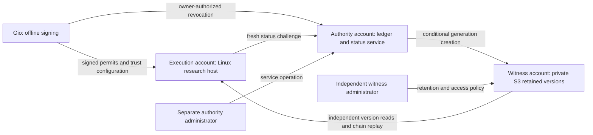

# SEED infrastructure proposal: local first, no new spending

**Status: revised for Gio's no-budget constraint.** On 2026-10-20, Gio stated
that there is no budget and no plan to spend for now. The active recommendation
is to use existing equipment and services for engineering, with no new paid
resources or service purchases. The cloud design below is deferred reference.
This document creates no
resources, account, credentials, keys, permit, signature, spending commitment,
deployment approval, or execution authority.

## Intended outcome

Give SEED a repeatable local workbench for its developmental learning programme:
reliable measurements, inspectable evidence and a clear path toward a small
deterministic Nursery. This advances engineering with the equipment already
available. It does not demonstrate general learning, grounded communication,
scientific reasoning or portability to every platform.

The deferred execution design describes admissions checked against independently
retained revocation evidence. That control research supports trustworthy
evaluation; it is not SEED's cognition.

The design must preserve original registered science, resource caps, complete
failure accounting and owner control. A compromised or restored authority must
not convince the execution client to accept a permit that the independently
read witnessed chain revokes. An unreachable or inconsistent service denies
admission. Availability is not substituted for that requirement.

The latest supplied Stage A closure record's D1–D6 definitions control this
proposal. Older DEC03B headings describe earlier decision versions. Stage A
already has an independent PASS WITH FINDINGS review; its owner closure remains
unsigned. This proposal does not repeat that review or close it.

## Recommendation and alternatives

**Continue on the existing Windows PC and Ubuntu/WSL. Do not provision cloud
infrastructure now.** This environment has already run the repaired engineering
suite: 1,653 tests and seven deterministic scenarios. That is useful local
development evidence, not qualification as the registered I31 execution host.

Use disposable Linux-filesystem workspaces for Linux checks, canonical Git
source bytes, the existing dependency lock and the installed runtimes. Keep the
installed learner and supplied evidence separate. Microsoft recommends storing
Linux-worked files in the Linux filesystem.
[WSL filesystem guidance](https://learn.microsoft.com/en-us/windows/wsl/filesystems).

Keep the existing standard public-repository CI for cross-platform engineering
verification. GitHub documents free standard-hosted-runner use for public
repositories; larger runners and paid storage are separate. Do not enable larger
runners, paid storage, paid APIs, model training services, subscriptions or
trial-credit infrastructure. Existing CI artifacts retain their bounded current
policy; CI is not a permanent independent witness.
[GitHub Actions billing](https://docs.github.com/en/billing/concepts/product-billing/github-actions).

### Work that can progress with existing resources

1. Complete review and integration readiness for the evaluator repairs, retaining
   literal measurements, genuine replay and explicit unavailable evidence.
2. Prepare the next narrow engineering design for frozen A/C reproduction and
   suite/retention accounting. A design proposal does not change caps, dispatch
   locks, evidence retention or admission rules.
3. Record the minimal Nursery question, deterministic-world boundaries and
   dependencies. Result-dependent B11 choices and acceptance claims still await
   I31; no substitute scientific result is manufactured from technical fixtures.
4. Keep the original scientific admission gates visible. Revisit execution only
   when qualifying existing/donated resources and genuinely independent
   administrators are available, or an explicitly reviewed owner design decision
   establishes a different acceptable scope.

New infrastructure/service spending allowance for this recommendation is **$0**.
Existing electricity, hardware and current account subscriptions are not claimed
to have no cost. The separate Codex work limit remains **45% weekly remaining**.

A single PC, multiple VMs on that PC, different folders or separate GitHub
branches do not establish independent administrators or durable nonrollback
evidence. Local emulation can test engineering behavior; it does not satisfy
the current four-domain deployment claim. No new provider, region, budget or
personnel decision is needed to continue the bounded engineering work above.

### Deferred qualified execution design

If the prerequisites and a later budget are established, the earlier priced
candidate is **two Linux VMs and one private S3 witness bucket across separately
administered accounts**. One VM executes research; the other hosts the authority.
No GPU is proposed. The existing learner is CPU based.

| Option | Arrangement | Trade-off |
|---|---|---|
| **Recommended now** | Existing PC and WSL, disposable technical fixtures, existing standard CI | No new paid infrastructure. Engineering work only; four-domain qualification remains unmet. |
| Deferred AWS | AWS execution account, separate authority account, separate witness account | EC2 instance roles provide temporary AWS credentials; fewer additional credential systems to operate. Requires a later budget and independent administration. |
| Existing hardware | Suitable spare native Linux execution host; AWS authority and witness | Saves incremental execution compute charges if hardware already exists. Adds host operation, connectivity, and external read-credential management. |
| Mixed provider | Linux execution VM from another provider; AWS authority and witness | Provider diversity, with another account and external AWS authentication to maintain. No security improvement is assumed solely from diversity. |

EC2 roles support temporary credentials. External hosts can use IAM Roles
Anywhere, but that introduces X.509 certificate management; it is not free
operational simplicity. These are considerations for the deferred cloud option;
three AWS accounts alone do not establish independence.
[EC2 roles](https://docs.aws.amazon.com/IAM/latest/UserGuide/id_roles_use_switch-role-ec2.html);
[Roles Anywhere](https://docs.aws.amazon.com/rolesanywhere/latest/userguide/introduction.html).

## Deferred host and credential proposal

| Component | Proposed starting configuration | Boundary |
|---|---|---|
| Execution | Native Linux VM, x86-64, 4 vCPU, 8 GiB RAM, 80 GiB disk, local ext4 research volume | Sizing assumption, not demonstrated capacity. No owner/authority signing key and no witness write permission. |
| Authority | Separate Linux VM, 2 vCPU, 2 GiB RAM, 20 GiB disk; HTTPS status and administration endpoints | Own status/head signing material and scoped generation-write role. No owner signing material or witness administration. |
| Witness | Private S3 general-purpose bucket, versioning, default Object Lock COMPLIANCE retention | Separate account and administrator. Signed public metadata remains private to admitted readers. |
| Owner | Gio's existing or subsequently approved offline signing environment | Gio personally signs after governance method/key binding is established. This task generates no key. |

“Dedicated research host” means assigned exclusively to this work; it does not
mean purchasing AWS Dedicated Host physical tenancy. The authority sizing is
consistent with the documented `t3.small` CPU/memory shape, but choosing an exact
instance and CPU-credit mode is part of the priced configuration review.
[EC2 instance specifications](https://docs.aws.amazon.com/ec2/latest/instancetypes/gp.html).

Propose Ubuntu 24.04 LTS with a separately pinned CPython 3.13 runtime and the
existing dependency lock. Ubuntu's standard security maintenance runs through
May 2029, but its default Python package is 3.12. A 3.13 runtime therefore needs
an explicit source, patch/update policy and execution-profile identity; it must
not be assumed to come from the default distribution package.
[Ubuntu lifecycle](https://ubuntu.com/about/release-cycle);
[Noble Python package](https://packages.ubuntu.com/noble/python3);
[Python version lifecycle](https://devguide.python.org/versions/).

Keep the current 512 MiB worker/coordinator ceilings, 120-second run ceiling,
1,800-second suite ceiling, 16 GiB root accounting and all other registered caps.
VM RAM does not raise a scientific limit. Timing and storage margins require
actual approved host qualification. The Windows/WSL workspace used for engineering
checks is not declared the qualified execution host.

Establish administration and recovery separation for all four trust domains:
owner/offline signing, execution, authority and witness. Record each domain's
operator, logins, devices and recovery paths. A shared organization administrator
or shared recovery credential that can acquire multiple roles is a common
control point that must be documented and resolved against the threat model.
Four account labels do not establish four independent trust domains. Gio must
assign the real operators; none are invented here.

## Deferred witness storage: required design refinements

The supplied DEC03B design is a useful starting point, but its initial AWS
permission/listing outline is insufficient for a deployment claim.

1. **Retain and inspect object versions.** Object Lock protects retained versions.
   It does not prevent a new version or delete marker at the same key. Use
   version-aware enumeration and reject unexpected versions, markers, gaps and
   competing objects for a generation. Do not infer the trusted chain from a
   normal key listing.
   [Object Lock semantics](https://docs.aws.amazon.com/AmazonS3/latest/userguide/object-lock.html);
   [Operational considerations](https://docs.aws.amazon.com/AmazonS3/latest/userguide/object-lock-managing.html).

2. **Require conditional creation.** Generation uploads use `If-None-Match: *`,
   enforced by reviewed bucket policy. A `412` initiates exact-object
   reconciliation, not an automatic success or overwrite. A current delete
   marker can make conditional creation succeed, so runtime deletion denial and
   version inspection are both necessary.
   [Conditional writes](https://docs.aws.amazon.com/AmazonS3/latest/userguide/conditional-writes.html);
   [Policy enforcement](https://docs.aws.amazon.com/AmazonS3/latest/userguide/conditional-writes-enforce.html).

3. **Resolve retention permissions.** The older design requires retention headers
   on upload while denying the writer `s3:PutObjectRetention`. AWS documents
   that permission as conditionally required when upload sets retention.
   Propose a witness-admin-controlled default COMPLIANCE policy, with writer
   overrides denied. Independently verify the actual retention of the exact
   stored version before accepting commitment. The final IAM policy must be
   reviewed and tested; this paragraph is not a deployable policy.
   [AWS permission mapping](https://docs.aws.amazon.com/AmazonS3/latest/userguide/using-with-s3-policy-actions.html).

4. **Read exact identities with sufficient permissions.** The reader needs
   `s3:ListBucketVersions`, `s3:GetObjectVersion` and `s3:GetObjectRetention`,
   scoped to the witness. Walk all enumeration pages, retrieve admitted
   `VersionId` values, verify signed contents and retention metadata, and replay
   the chain to pinned genesis. The older `ListBucket`/`GetObject` pair alone
   does not provide this path. Authority recovery must have a separately
   controlled read procedure rather than silently broadening its writer role.
   [Version enumeration](https://docs.aws.amazon.com/AmazonS3/latest/API/API_ListObjectVersions.html);
   [Exact-version retrieval](https://docs.aws.amazon.com/AmazonS3/latest/API/API_GetObject.html).

S3's strong read-after-write and LIST consistency is useful. It does not make a
paginated walk and subsequent worker admission one atomic transaction. The
reviewed protocol must define how a changing tip causes retry/refusal and retain
its precise admission linearization boundary.
[S3 consistency](https://docs.aws.amazon.com/AmazonS3/latest/userguide/Welcome.html#ConsistencyModel).

Propose **400 days** as the initial retention floor, carried forward from DEC03B
for owner review. Locked retention has continuing storage obligations and cannot
be casually shortened. Review an extension before the evidence horizon expires.
Use separate lifecycle rules for operational logs and scientific artifacts;
neither is silently substituted for the witnessed chain.

Prefer server-managed S3 encryption for this small witness unless a specific
customer-managed-key requirement is approved. Loss of decryption access, account
closure, retention expiry, or network access remains an availability boundary.
WORM does not establish truthful content, permanent availability, or immunity to
the cloud provider's account lifecycle.

## Deferred admission and qualification

Preserve the Stage A finding boundary: every execution client independently
replays the witnessed chain and compares the fresh nonce-bound signed status.
A status-only consumer is unacceptable. CP2R3-NEW-01 and CP2R3-NEW-02 remain
recorded limitations; this infrastructure proposal does not erase them.

Use the pinned `ssh-keygen -Y verify` path with the expected principal, namespace
and revocation policy. Do not substitute `check-novalidate` for authorized-signer
verification. The actual host must demonstrate the needed SSHSIG/KRL behavior;
the presence of an OpenSSH binary is not evidence of interoperability.
[OpenSSH manual](https://man.openbsd.org/ssh-keygen).

Before later execution admission, the reviewable qualification record must bind:

- Exact source SHA, dependency lock, interpreter/build profile, OS, architecture,
  filesystem, verified SSH verifier path/binary, and trust configuration.
- Stable descriptor-verified evaluator root identity across processes and the
  separately scheduled reboot qualification.
- Actual endpoint rollback/revocation/expiry/fork/rotation negative evidence,
  failure behavior for network and clocks, and recovery from interrupted writes.
- Durable one-use execution-ledger evidence: concurrent claims cannot both
  start, an ambiguous-start crash remains consumed, and consumption survives
  restore and reboot. The Stage A fixture did not demonstrate the distributed
  persistent ledger; revocation-chain replay alone cannot establish it.
- Independent operator assignments and credential-scope evidence.
- Separate pre-freeze and post-freeze owner permits; no circular future receipt
  field and no test bypass for the canonical registered identity.

The registered frozen A/C reexecution gap and the 30-original/30-reproduction
retention-margin conflict remain separate prerequisite designs. Moving to a VM
does not solve either. No canonical freeze, IMP-01+ enablement, Stage B deployment,
P2 execution, I31 run or G7 acceptance is performed by this proposal.

## Deferred cloud cost comparison and operating controls

The following figures are retained for possible future comparison. They do not
fit Gio's current $0 new-spending constraint and are not the active recommendation.

The following indicative estimate was checked against AWS's live public pricing
feeds on **2026-10-20**, in USD, for **US East (N. Virginia)**. This is a comparison
region, not a selected deployment location or spending approval. Reprice the
chosen region and configuration before provisioning; no free tier, discount,
reservation or tax assumption reduces these numbers.

| Item | Verified unit price | 40 execution hours/month | Both hosts always on |
|---|---:|---:|---:|
| Execution: Linux `c7i.xlarge`, 4 vCPU / 8 GiB | $0.1785/hour | $7.14 | $130.305 |
| Authority: Linux `t3.small`, 2 vCPU / 2 GiB, 730 hours | $0.0208/hour | $15.184 | $15.184 |
| gp3 disks, 80 + 20 GiB retained all month | $0.08/GB-month | $8.00 | $8.00 |
| One public IPv4 per running host | $0.005/address-hour | $3.85 | $7.30 |
| Illustrative witness: 1 GB stored, 1,000 PUT/LIST and 10,000 GET requests/month | $0.023/GB-month; $0.005/1,000 writes; $0.0004/1,000 reads | $0.032 | $0.032 |
| **Subtotal, rounded** | | **$34.21/month** | **$160.82/month** |

Rates: [EC2 regional pricing feed](https://b0.p.awsstatic.com/pricing/2.0/meteredUnitMaps/ec2/USD/current/ec2-ondemand-without-sec-sel/US%20East%20(N.%20Virginia)/Linux/index.json),
[EBS pricing feed](https://b0.p.awsstatic.com/pricing/2.0/meteredUnitMaps/ec2/USD/current/ebs.json),
[S3 Standard pricing feed](https://b0.p.awsstatic.com/pricing/2.0/meteredUnitMaps/s3/USD/current/s3-standard.json),
[public IPv4 pricing](https://aws.amazon.com/vpc/pricing/).

The comparison uses 730 hours for an always-on month and standard gp3 included
performance. The witness line is an explicit calculation example, not a measured
volume forecast; retained versions accumulate across the 400-day horizon.
Logs, snapshots, egress, DNS, tax and other services are excluded. Retaining an
execution Elastic IP during its 690 idle hours adds $3.45 to the intermittent
case. Dynamic addressing requires an approved trust-preserving update procedure.
Set the burstable authority's credit mode deliberately: extra CPU credits are
excluded, and a no-overage choice can throttle sustained use. Actual host
qualification still determines whether this sizing is adequate.

If cloud execution is reconsidered later, compare the intermittent execution
case first. Obtain a dated itemized quote including omitted operational costs
and a contingency before Gio chooses any nonzero ceiling. Existing suitable
execution hardware remains a useful comparison if available.

Budget explicitly for:

`execution hours × rate + authority hours × rate + disks/snapshots + public IPv4
+ retained S3 GB-months + PUT/GET/LIST requests + logging + egress + DNS + taxes`.

Use the current provider prices for each term. Do not repeat DEC03B's historical
“far below US$1/month” storage estimate as a current total. Record capacity,
request and log-volume assumptions, retention obligations, and a contingency
line. Gio sets the ceilings after seeing the complete quote.
[S3 pricing dimensions](https://aws.amazon.com/s3/pricing/).

Budget notifications are alerts, not hard spending caps; delayed billing can
allow overshoot. Restrict allowed resource types/counts, avoid unreviewed CPU
credit overage and automatic scaling, and stop new compute/admissions when the
approved operating allowance is exhausted. Preserve already locked evidence;
turning off compute does not end retention charges.
[AWS Budgets limitations](https://docs.aws.amazon.com/cost-management/latest/userguide/budgets-managing-costs.html).

## Deferred deployment decisions

These decisions remain necessary for the current qualified-execution design;
they are not prerequisites for continuing local engineering. Gio's current
spending decision is already known and does not need reconfirmation.

| Latest decision | Current disposition | Required only before later deployment/admission |
|---|---|---|
| D1 | Cloud deployment deferred; existing local development environment continues | Provider/region/accounts and named administrators if deployment is reconsidered |
| D2 | 400-day witness retention floor with proactive extension review | Retention obligation and evidence horizon acceptance |
| D3 | Administration and recovery separation across owner/offline, execution, authority and witness domains | Real personnel, credential, device and recovery assignments for all four domains |
| D4 | Existing Windows/WSL for engineering; no qualified research host claimed | Exact host and qualification schedule |
| D5 | $0 new infrastructure/service spending; no provisioning | Any later change to budget requires an explicit owner decision and priced configuration |
| D6 | Preserve mandatory chain replay and reviewed I7/rotation/expiry rules | Exact policy ratification after the deployment amendment is reviewed |

Proceed with bounded local engineering and design preparation under the active
assignment. Provisioning, owner signing, target-host experiments and scientific
dispatch remain separate concrete actions with their required decisions and
evidence. This proposal neither completes the unsigned Stage A record nor
changes the scope of I31.
